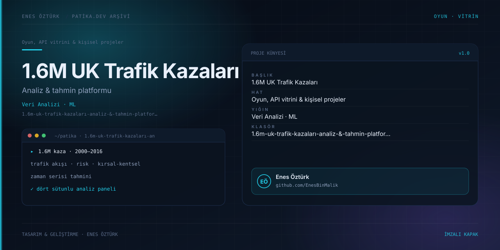

# 1.6M UK Trafik Kazaları Analiz & Tahmin Platformu



> **Patika.dev arşivi · Veri analizi & görselleştirme** — tasarım ve geliştirme: **Enes Öztürk**

---

Bir buçuk milyon satırlık İngiltere trafik kaza kaydını dört analiz sütununa bölen yönetim paneli: trafik akışı, risk faktörleri, zaman serisi tahmini ve kırsal–kentsel ayrım.

## Öne çıkanlar

- **Trafik akışı** — yıl, ay, saat ve yol tipine göre kaza yoğunluğu.
- **Risk faktörleri** — hava durumu, yol yüzeyi, ışık koşulları ve hız limiti kırılımı.
- **Zaman serisi tahmini** — geçmiş yıllardan hareketle dönemsel beklenti.
- **Kırsal–kentsel karşılaştırma** — bölge tipine göre şiddet ve sıklık farkı.
- Yönetici özeti raporu ve bölgesel harita bölümleri.

## Teknoloji

React · TypeScript · Vite. Her klasör kendi `package.json`'ına sahip bağımsız bir projedir; kök dizinde kurulum yapılmaz.

## Kurulum ve çalıştırma

```bash
cd "1.6m-uk-trafik-kazaları-analiz-&-tahmin-platformu"
npm install
npm run dev
```

| Komut | Not |
| --- | --- |
| `npm install` | bağımlılıklar |
| `npm run dev` | http://localhost:3000 |
| `npm run build` | üretim derlemesi |
| `npm run lint` | tsc --noEmit |

## Proje yapısı

```
1.6m-uk-trafik-kazaları-analiz-&-tahmin-platformu/
├── index.html
├── package.json
├── docs/cover.svg            # imza kapak
└── src/
    ├── App.tsx               # ekranların birleştiği yer
    ├── main.tsx
    ├── assets/
    ├── components/
    └── data/
```

## Lisans

Ödev ve portföy amaçlı çalışma; tüm hakları **Enes Öztürk**'e aittir.
