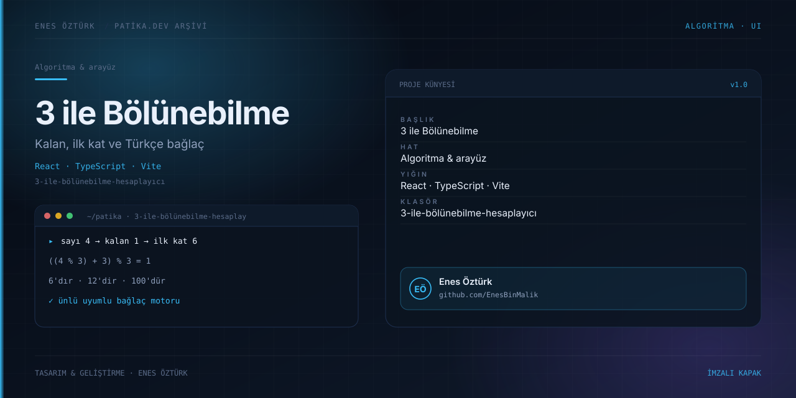

# 3 ile Bölünebilirlik ve En Yakın Bölünebilen Sayı Hesaplayıcı



> **Patika.dev · JavaScript patikası — 3 ile bölünebilme ödevi** · Enes Öztürk

## Ne yapıyor?

Girilen tam sayının 3'e bölünüp bölünmediğini söyler; bölünmüyorsa **üzerine çıkan ilk bölünebilen
sayıyı** ve bu sayıya ulaşmak için **eklenmesi/çıkarılması gereken miktarı** verir. Rakam toplamı
kuralını adım adım açıklar, geçmişi listeler, başarılı sonuçta konfeti ve ses efekti kullanır.

Formül (`src/utils/divisibility.ts:81-104`):

```
pozitifKalan  = ((sayi % 3) + 3) % 3          // negatif girdide de 0|1|2 üretir
eklenecek     = 3 − pozitifKalan              // kalansızsa 0
ilkBolunebilen = sayi + eklenecek
oncekiBolunebilen = sayi − pozitifKalan
```

Örnek: `4 → kalan 1 → eklenecek 2 → ilk 6` · `−9 → kalan 0 → bölünür`.

## Öne çıkanlar

- **Girdi doğrulama** (`divisibility.ts:40-71`): boş değer, ondalık/harf içeren girdi ve
  `Number.isSafeInteger` dışı değerler için ayrı Türkçe hata mesajları.
- **Türkçe bağlaç eki** (`src/utils/turkishGrammar.ts:17`): sonucu `6'dır`, `12'dir`, `100'dür` gibi
  ünlü uyumuna uygun üretiyor — ödev metnindeki cümle bozulmuyor.
- **Rakam toplamı analizi**: basamak dizisi + toplamı sonuç nesnesinde taşınır, açıklamada gösterilir.
- **Geçmiş**: tekrar eden girişi yığının başına eklemiyor (`App.tsx:70`), state'te tutulur,
  `localStorage` kullanılmaz.
- **Ses ve konfeti**: `AudioContext` ile üretilen üç ton (`utils/audio.ts:23`) ve `canvas-confetti`
  (`App.tsx:57`); ses arayüzden açılıp kapatılabiliyor.

## Teknoloji

React 19 · TypeScript · Vite 8 · Tailwind v4 · `canvas-confetti` · `lucide-react`

## Kurulum ve çalıştırma

```bash
npm install
npm run dev        # http://localhost:3000
```

`npm run build`, `npm run preview` normal çalışır; `npm run lint` yalnız `tsc --noEmit`tır;
`npm run clean` Windows'ta çalışmaz (`rm -rf`) ve depoda olmayan `server.js`'yi hedefler.

## Proje yapısı

```
3-ile-bölünebilme-hesaplayıcı/
├── src/App.tsx                    # state, hesaplama, geçmiş, konfeti/ses tetiklemesi
├── src/utils/{divisibility,turkishGrammar,audio}.ts
├── src/components/                # Header, CalculatorForm, ResultCard, EducationalBreakdown,
│                                   HistoryList, CodeModal
└── docs/cover.svg
```

## Bilinen kısıtlar ve yapılacaklar

- [ ] Hesaplayıcı yalnız **3** sabitine çalışıyor; bölen parametrik hâle getirilebilir.
- [ ] Geçmiş kalıcı değil — sayfa yenilenince kaybolur.
- [ ] Kullanılmayan bağımlılıklar: `@google/genai`, `express`, `@types/express`, `dotenv`, `motion`,
      `autoprefixer`, `esbuild`, `tsx`; `package.json` adı `react-example`.
- [ ] `metadata.json` ve README AI Studio şablonunu anlatıyordu; bu dosya gerçek ödevi anlatıyor.
- [ ] `divisibility.ts` için Vitest birim testi yok — `pozitifKalan`, negatif girdi ve `Number.MIN_SAFE_INTEGER`
      sınırları test edilmeli.
- [ ] Büyük sayılarda rakam toplamı `Math.abs(sayi).toString()` üzerinden gidiyor; `bigint` girdisi
      desteklenmiyor (bağlaç fonksiyonu `bigint` kabul ediyor ama hesaplayıcı etmiyor).

## Lisans

Ödev amaçlı çalışma; Enes Öztürk'e ait.
