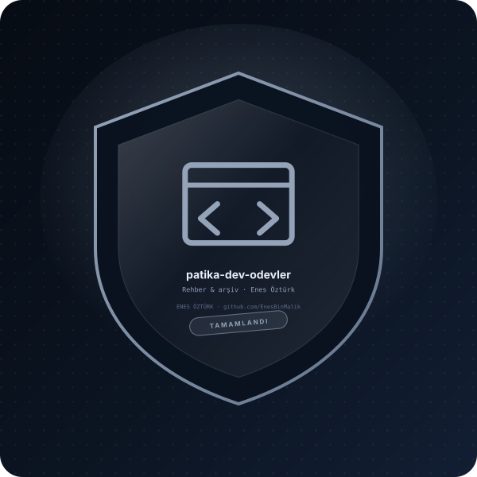

# patika-dev-odevler



> **Rehber & arşiv** — tasarım ve geliştirme: **Enes Öztürk**

---

patika-dev-odevler — Enes Öztürk tarafından geliştirilmiş proje..

## Öne çıkanlar

- Konu anlatımı ve örnekler
- Adım adım kurulum
- Sık karşılaşılan hatalar
- İleri okuma bağlantıları

## Kurulum ve çalıştırma

```bash
npm install
npm run dev        # http://localhost:3000
```

| Komut | Not |
| --- | --- |
| `npm install` | bağımlılıklar |
| `npm run dev` | geliştirme sunucusu |
| `npm run build` | üretim derlemesi |

## Proje yapısı

```
├── index.html
├── package.json
├── docs/rozet.svg        # imza rozeti
└── src/                  # uygulama kaynakları
```

## Lisans

Bu proje **Enes Öztürk** tarafından geliştirilmiştir; tüm hakları saklıdır.
