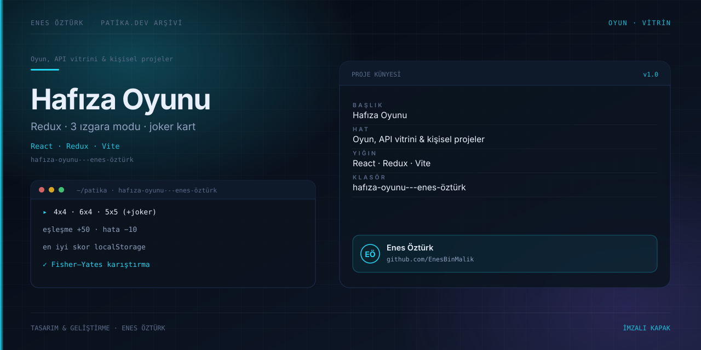
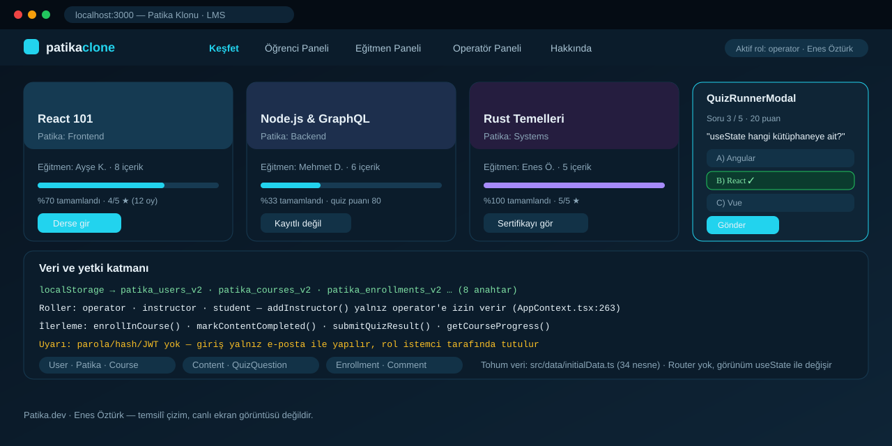
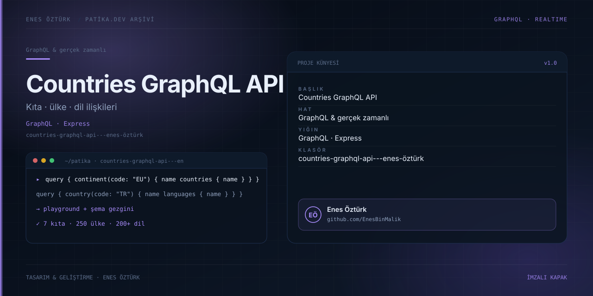
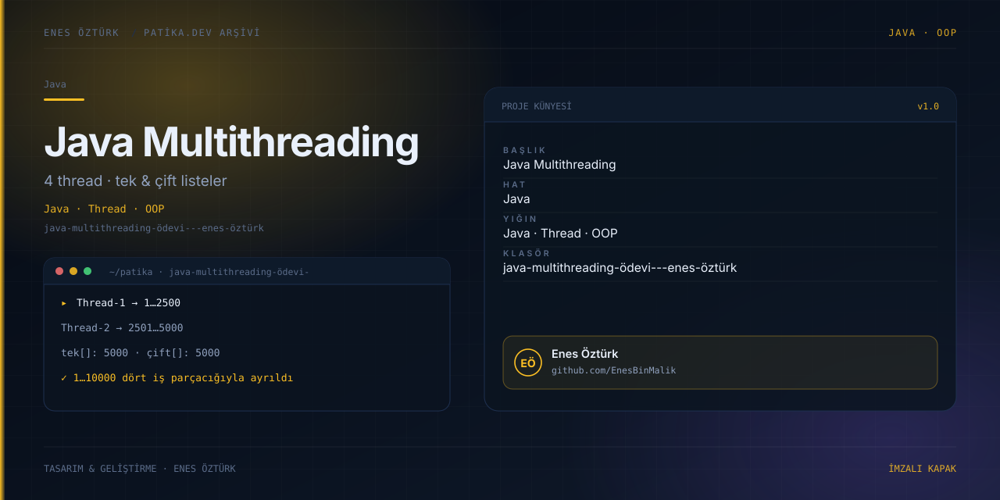
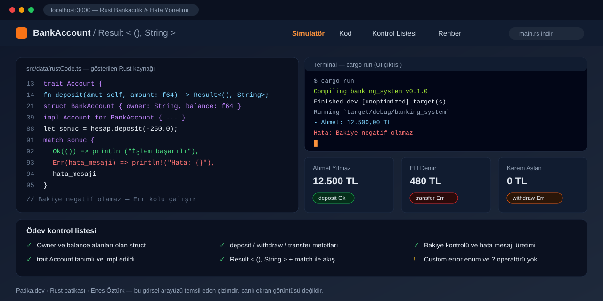

<div align="center">

# 📚 Patika.dev Ödevleri & Projeler

**Enes Öztürk**

Patika.dev eğitimleri kapsamında hazırladığım ödevler ve kişisel projeler

[](https://github.com/EnesBinMalik)

</div>

---

## 📖 Ödevler

| # | Eğitim | Ödev | Teknolojiler | Durum |
|:-:|---|---|---|:-:|
| 1 | Node.js | [JSONPlaceholder API ile veri çekme](nodejs/odev-1) | Node.js · Axios · Async/Await | ✅ |
| 2 | React | [Todo Uygulaması](react/odev-2) | React 19 · TypeScript · Vite · Tailwind CSS | ✅ |

## 🚀 Projeler

| Proje | Açıklama | Teknolojiler | Durum |
|---|---|---|:-:|
| 🌦️ [Meteoroloji](projeler/meteoroloji) | Türkiye'nin 81 ili için anlık, saatlik ve 7 günlük hava durumu | React · TypeScript · Context API · Open-Meteo | ✅ |
| ♟️ [Türk Daması](projeler/turk-damasi) | Aynı cihazda iki kişilik, ceviz/şimşir temalı Türk Daması | React · TypeScript · Redux Toolkit · Web Audio | ✅ |
| 🏛️ [Ajans Portföy & Yönetim Platformu](projeler/ajans-portfolyo) | Dinamik portföy CRUD, mesaj gelen kutusu, ekip/hizmet bölümleri ve dağıtım rehberi | React · TypeScript · Tailwind CSS · localStorage | ✅ |
| ✦ [Freelancer Portföy](projeler/freelancer-portfolyo) | Kişisel freelance vitrin: proje grid'i, detay modalı, CV indirme ve gelen kutusu | React · TypeScript · Tailwind CSS · localStorage | ✅ |
| 💪 [Misfit Fitness](projeler/misfit-fitness) | Rol bazlı spor yönetimi: antrenman CRUD, üye kaydı, eğitmen paneli, mesajlar ve galeri | React · TypeScript · Context API · localStorage | ✅ |

## 🧩 Bağımsız klasörlerdeki ödevler

Kök dizinde kendi klasörüyle duran, dokümantasyonu güncellenmiş ödevler:

| Ödev | Ne yapılıyor | Yığın | Kapak |
|---|---|---|---|
| [Hafıza Oyunu](hafıza-oyunu---enes-öztürk) | 4x4 / 5x5 / 6x4 tahtalarda kart eşleştirme, joker kartı, `+50 / -10` puan, en iyi skor kaydı | React 19 · Redux Toolkit · Tailwind v4 |  |
| [Patika Klonu LMS](patika-klonu---eğitim-ve-öğrenim-yönetim-platformu) | Operatör/eğitmen/öğrenci panelleri, ders-içerik-quiz CRUD, ilerleme ve yorumlama | React 19 · Context API · localStorage |  |
| [Countries GraphQL API](countries-graphql-api---enes-öztürk) | Express üzerinde `graphql-js` sunucusu, ilişkili şema ve tarayıcı sorgu stüdyosu | Express · graphql-js · Vite · React |  |
| [Java Multithreading](java-multithreading-ödevi---enes-öztürk) | Thread/Runnable/ExecutorService kodlarının gösterimi ve 4 thread simülasyonu | React 19 · Vite (Java kaynağı viewer) |  |
| [Rust Bankacılık & Hata Yönetimi](rust-bankacılık-sistemi-&-hata-yönetimi) | `Result<(), String>` + `match` ile hesap işlemlerinin incelenmesi ve simülasyonu | React 19 · Vite (Rust kaynağı viewer) |  |

> Java ve Rust klasörlerindeki kaynak kod tarayıcıda gösterilir; derleme yapılmaz. Her klasörün README'si
> bu ayrımı ve gerçek çalıştırma adımlarını açıklıyor.

## 🗂️ Dizin yapısı

```
patika-dev-odevler/
├── nodejs/
│   └── odev-1/                # Node.js Ödev 1 — JSONPlaceholder + Axios
├── react/
│   └── odev-2/                # React Ödev 2 — Todo uygulaması
└── projeler/
    ├── ajans-portfolyo/       # Ajans — portföy & web yönetim platformu
    ├── freelancer-portfolyo/  # Freelancer — kişisel portföy
    ├── meteoroloji/           # Meteoroloji — Türkiye 7 günlük hava durumu
    ├── misfit-fitness/        # Misfit — rol bazlı fitness yönetimi
    └── turk-damasi/           # Türk Daması — iki kişilik tahta oyunu
```

## ▶️ Çalıştırma

Her klasör kendi bağımsız projesidir. İlgili klasöre girip README dosyasındaki adımları izleyin:

```bash
cd nodejs/odev-1        # veya: react/odev-2 · projeler/*
npm install

node src/app.js         # Node.js ödevi
npm run dev             # React projeleri (http://localhost:3000)
```

## 🛠️ Kullanılan teknolojiler


## 📌 Notlar

- `node_modules`, `.env` ve derleme çıktıları `.gitignore` ile hariç tutulur.
- Her proje kendi `package.json` dosyasıyla bağımsız çalışır.
- Ödevler Patika.dev müfredatına göre numaralandırılmıştır.
- Portföy ve fitness projeleri tamamen istemci tarafında çalışır; veriler `localStorage`'da saklanır.

---

<div align="center">

**Enes Öztürk** · [@EnesBinMalik](https://github.com/EnesBinMalik)

</div>
