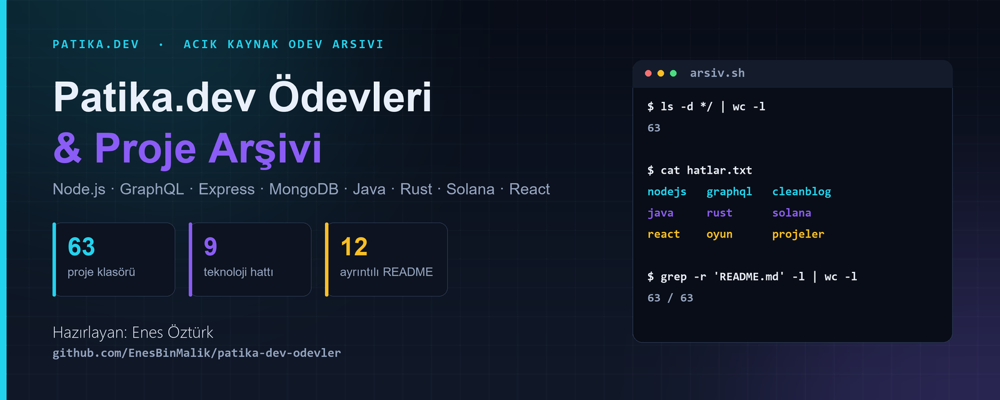

<div align="center">



# Patika.dev · Proje Galerisi

**Enes Öztürk** &nbsp;·&nbsp; Öğrenirken ürettiklerim; kod, arayüz ve deneyler.

[](https://github.com/EnesBinMalik)
[](#teknoloji-haritası)
[](#proje-galerisi)

</div>

---

## Merhaba 👋

Bu depo, Patika.dev eğitim sürecimde geliştirdiğim ödevleri ve kişisel proje denemelerini bir araya getiriyor. Galeri; Node.js, GraphQL, React, TypeScript, Java, Rust ve Web3 başlıklarında gezilebilir. Projelerin çoğu etkileşimli öğrenme arayüzleri; bazı klasörlerde ayrıca çalıştırılabilir sunucu ya da dil kaynağı bulunuyor. Her karttan ilgili klasöre, README'si varsa proje açıklamasına geçebilirsin.

> **Şeffaflık notu:** Arayüzde gösterilen kod, test sonucu veya simülasyon her zaman aynı teknolojide çalışan bir uygulama anlamına gelmez. Java/PHP ödevlerinin bir kısmı React arayüzünde kavram gösterir; gerçek sunucu ve kaynak dosyaları proje README'lerinde ayrıca belirtilmiştir. Bir demo çıktısını gerçek test/derleme sonucu olarak değerlendirme.

## Proje galerisi

<div align="center">
<table>
<tr>
<td width="50%" valign="top">
<a href="<3-ile-bölünebilme-hesaplayıcı>">" alt="3 ile bölünebilirlik hesaplayıcı kapağı" width="100%" /></a>
<h3><a href="<3-ile-bölünebilme-hesaplayıcı>">3 ile Bölünebilirlik</a></h3>
<p>Negatif sayılar dahil bölünebilirlik, rakam toplamı ve sonuç geçmişi için etkileşimli matematik aracı.</p>
<sub>React · TypeScript · Algoritma</sub>
</td>
<td width="50%" valign="top">
<a href="<anonymous-chat---graphql-&-redis-pubsub>">" alt="Anonim GraphQL sohbet proje kapağı" width="100%" /></a>
<h3><a href="<anonymous-chat---graphql-&-redis-pubsub>">Anonymous Chat</a></h3>
<p>GraphQL, WebSocket abonelikleri ve Redis PubSub yaklaşımını gösteren gerçek zamanlı sohbet.</p>
<sub>GraphQL · Redis · WebSocket</sub>
</td>
</tr>
<tr>
<td width="50%" valign="top">
<a href="<clean-blog---ödev-7>">" alt="Clean Blog proje kapağı" width="100%" /></a>
<h3><a href="<clean-blog---ödev-7>">Clean Blog · İlk Sunucu</a></h3>
<p>Blog ödev serisinin başlangıcı: Express sunucusu ve blog akışına ait temel çalışma.</p>
<sub>Node.js · Express · Blog</sub>
</td>
<td width="50%" valign="top">
<a href="<countries-graphql-api---enes-öztürk>">" alt="Countries GraphQL API proje kapağı" width="100%" /></a>
<h3><a href="<countries-graphql-api---enes-öztürk>">Countries GraphQL API</a></h3>
<p>Ülke verileri, ilişkili sorgular ve şema keşfi için API odaklı çalışma.</p>
<sub>GraphQL · TypeScript · API</sub>
</td>
</tr>
<tr>
<td width="50%" valign="top">
<a href="<hafıza-oyunu---enes-öztürk>">" alt="Hafıza oyunu proje kapağı" width="100%" /></a>
<h3><a href="<hafıza-oyunu---enes-öztürk>">Hafıza Oyunu</a></h3>
<p>Kart eşleştirme, skor ve oyun durumunu bir araya getiren tarayıcı oyunu.</p>
<sub>React · Redux Toolkit · Oyun</sub>
</td>
<td width="50%" valign="top">
<a href="<java-multithreading-ödevi---enes-öztürk>">" alt="Java multithreading proje kapağı" width="100%" /></a>
<h3><a href="<java-multithreading-ödevi---enes-öztürk>">Java Multithreading</a></h3>
<p>Thread, Runnable ve ExecutorService kavramlarını anlatan etkileşimli öğrenme arayüzü.</p>
<sub>Java kavramları · Görsel anlatım</sub>
</td>
</tr>
<tr>
<td width="50%" valign="top">
<a href="<patika-klonu---eğitim-ve-öğrenim-yönetim-platformu>">" alt="Eğitim ve öğrenim yönetim platformu proje kapağı" width="100%" /></a>
<h3><a href="<patika-klonu---eğitim-ve-öğrenim-yönetim-platformu>">Öğrenim Yönetim Platformu</a></h3>
<p>Öğrenci, eğitmen ve operatör akışlarını içeren eğitim platformu konsepti.</p>
<sub>React · Context API · Eğitim</sub>
</td>
<td width="50%" valign="top">
<a href="<rust-bankacılık-sistemi-&-hata-yönetimi>">" alt="Rust bankacılık sistemi proje kapağı" width="100%" /></a>
<h3><a href="<rust-bankacılık-sistemi-&-hata-yönetimi>">Rust · Bankacılık ve Hata Yönetimi</a></h3>
<p>Result ve match desenleri üzerinden hata yönetimini keşfetmek için görsel laboratuvar.</p>
<sub>Rust kavramları · Simülasyon</sub>
</td>
</tr>
<tr>
<td width="50%" valign="top">
<a href="<clean-blog---ödev-10-(enes-öztürk)>">" alt="Clean Blog uygulaması proje kapağı" width="100%" /></a>
<h3><a href="<clean-blog---ödev-10-(enes-öztürk)>">Clean Blog · Tekil Sayfa ve Yönlendirme</a></h3>
<p>Blog arayüzünde sayfa geçişleri ve istemci tarafı veri akışına odaklanan seri halkası.</p>
<sub>React · Router · Blog</sub>
</td>
<td width="50%" valign="top">
<a href="<bookstore-webapi-unit-test-suite---enes-öztürk>">" alt="BookStore WebApi birim test laboratuvarı proje kapağı" width="100%" /></a>
<h3><a href="<bookstore-webapi-unit-test-suite---enes-öztürk>">BookStore · Birim Test Laboratuvarı</a></h3>
<p>Book, Genre ve Author senaryolarını ve Arrange–Act–Assert yaklaşımını inceleyen eğitim demosu. Arayüzdeki test sonuçları simülasyondur.</p>
<sub>React · TypeScript · xUnit örnekleri</sub>
</td>
</tr>
</table>
</div>

## Tüm projeler · konu başlıklarına göre

Aşağıdaki dizin, depo içindeki proje klasörlerine doğrudan gider. Klasör içindeki `README.md`, mevcut uygulama ve kaynaklar hakkında daha ayrıntılı bilgi verir.

<details open>
<summary><strong>01 · Node.js temelleri ve sunucular</strong></summary>

- [Node.js Ödev 1](<nodejs/odev-1>) · [Daire modülü](<ödev-3_-daire-modülü---enes-öztürk>) · [Dairenin alanı — CLI](<node.js-komut-satırı---dairenin-alanı-_-enes-öztürk>)
- [Node.js fs modülü](<node.js-fs-modülü---ödev-4-_-enes-öztürk>) · [Node.js web sunucusu](<node.js-web-sunucusu-(ödev-5)---enes-öztürk>) · [Koa.js web sunucusu](<koa.js-web-sunucusu---ödev-6>)
- [Clean Blog — Ödev 7](<clean-blog---ödev-7>) · [Clean Blog — Ödev 9](<clean-blog---enes-öztürk-(ödev-9)>) · [Clean Blog — Ödev 10](<clean-blog---ödev-10-(enes-öztürk)>) · [Clean Blog — Ödev 11](<clean-blog---ödev-11-(mvc,-update-&-delete)>) · [Clean Blog — Ödev 12](<clean-blog---ödev-12-(bölüm-6)>)

</details>

<details>
<summary><strong>02 · GraphQL, API ve gerçek zamanlı uygulamalar</strong></summary>

- [GraphQL sunucusu](<graphql-sunucusu---ödev-1-(enes-öztürk)>) · [GraphQL etkinlik yöneticisi](<graphql-event-manager---ödev-2-(enes-öztürk)>) · [GraphQL subscriptions stüdyosu](<graphql-subscriptions-studio---enes-öztürk>)
- [Apollo Client etkinlik portalı](<eventhub---apollo-client-&-graphql-etkinlik-portalı>) · [Countries GraphQL API](<countries-graphql-api---enes-öztürk>) · [Anonymous Chat — GraphQL & Redis](<anonymous-chat---graphql-&-redis-pubsub>)
- [Gerçek zamanlı etkinlik takibi](<gerçek-zamanlı-etkinlik-ve-katılımcı-takip-sistemi>) · [Realtime Voting App](<realtime-voting-app>) · [BookStore API — Model kullanımı](<bookstore-api---model-kullanımı-(enes-öztürk)>) · [BookStore Author & Book API Studio](<bookstore-author-&-book-management-api-studio>)

</details>

<details>
<summary><strong>03 · Java ve koleksiyonlar</strong></summary>

- [Java Multithreading](<java-multithreading-ödevi---enes-öztürk>) · [Java MyList — Generic sınıf](<java-mylist-generic-sınıfı---enes-öztürk>) · [Java Stream kitap listesi](<java-stream-kitap-listesi---enes-öztürk>) · [Kitap sıralayıcı](<kitap-sıralayıcı>)

</details>

<details>
<summary><strong>04 · Rust ve sistem programlama</strong></summary>

- [Rust bankacılık ve hata yönetimi](<rust-bankacılık-sistemi-&-hata-yönetimi>) · [Rust traits ve structs](<rust-bankacılık-sistemi-(traits-&-structs)---enes-öztürk>) · [Enum ve desen eşleştirme](<rust-enum-&-desen-eşleştirme-hesap-makinesi>)
- [Sahiplik ve referanslar laboratuvarı](<rust-sahiplik-ve-referanslar-laboratuvarı>) · [Özel filtreleme laboratuvarı](<rust-özel-filtreleme-laboratuvarı---enes-öztürk>) · [Rust envanter yönetimi](<paslı-mağaza---envanter-yönetim-sistemi>)

</details>

<details>
<summary><strong>05 · Web3 ve Solana</strong></summary>

- [Solana sayaç programı](<solana-sayaç-programı---enes-öztürk>) · [Solana token transferi](<solana-token-transfer---enes-öztürk-ödevi>) · [Restaurant Review dApp & Smart Contract](<solana-restaurant-review-dapp-&-smart-contract>) · [Afet yardımı ve DePIN analizi](<web3-düşünce-egzersizi_-afet-yardımı-&-depin-analizi---enes-öztürk>)

</details>

<details>
<summary><strong>06 · Algoritmalar, bileşenler ve test araçları</strong></summary>

- [3 ile bölünebilirlik hesaplayıcı](<3-ile-bölünebilme-hesaplayıcı>) · [Döngülerle üçgen çizme](<döngülerle-üçgen-çizme---enes-öztürk>) · [Geometrik şekiller — OOP](<geometrik-şekiller-oop-ödevi---enes-öztürk>) · [FluentValidation ödevi](<fluent-validation-ödevi---enes-öztürk>)
- [Paragraf oluşturucu](<paragraf-oluşturucu---enes-öztürk>) · [Klavye hız testi](<klavye-hız-testi---enes-öztürk>) · [Markdown Previewer Pro](<markdown-previewer-pro-—-enes-öztürk-signature>) · [PHP dizi filtreleme — TS simülasyonu](<php-dizi-filtreleyici-ve-rastgele-seçici>)
- [Button Component](<enes-öztürk-button-component>) · [Emoji arama ve test paketi](<react-emoji-search---test-paketi-&-canlı-koşucu>) · [NotesApp](<notesapp---enes-öztürk>) · [Post sıralama ve ekleme](<post-sıralama-ve-post-ekleme---enes-öztürk>) · [React Todo — Ödev 2](<react/odev-2>)
- [BookStore WebApi Unit Test Suite](<bookstore-webapi-unit-test-suite---enes-öztürk>)

</details>

<details>
<summary><strong>07 · Yönetim panelleri ve CRUD</strong></summary>

- [Etkinlik portalı](<etkinlik-portalı---ödev-6>) · [Patika eğitim platformu](<patika-klonu---eğitim-ve-öğrenim-yönetim-platformu>) · [PatikaStore](<patikastore---ürün-yönetim-sistemi>) · [Turizm acente sistemi](<patika-turizm-acente-sistemi>)
- [Mobilya ve iç mimarlık](<fikstür-mobilya-&-i̇ç-mimarlık---enes-öztürk>) · [Sigorta yönetim sistemi](<sigorta-yönetim-sistemi>) · [BookStore Author & Book API Studio](<bookstore-author-&-book-management-api-studio>)

</details>

<details>
<summary><strong>08 · Oyunlar, hava durumu, veri ve kişisel projeler</strong></summary>

- [Hafıza oyunu](<hafıza-oyunu---enes-öztürk>) · [Macera oyunu](<macera-oyunu---enes-öztürk>) · [Spend Bill Gates' Money](<spend-bill-gates'-money>) · [Türk daması](<projeler/turk-damasi>)
- [COVID-19 Tracker](<covid-19-tracker---enes-öztürk>) · [Türkiye hava durumu](<türkiye-hava-durumu-·-enes-öztürk>) · [Türkiye 7 günlük hava durumu](<enes-öztürk-meteoroloji-_-türkiye-7-günlük-hava-durumu>) · [Meteoroloji projesi](<projeler/meteoroloji>)
- [Elma yaprağı hastalıkları tespiti](<elma-yaprak-hastalıkları-tespiti---enes-öztürk>) · [Saatlik enerji ve hava durumu ML](<saatlik-enerji-talebi,-üretimi-ve-hava-durumu-ml-platformu>) · [Rick and Morty karakter portalı](<rick-ve-morty-karakter-portalı---enes-öztürk>)
- [Ajans portfolyo](<projeler/ajans-portfolyo>) · [Freelancer portfolyo](<projeler/freelancer-portfolyo>) · [MISFIT Fitness](<projeler/misfit-fitness>)

</details>

<details>
<summary><strong>09 · Ek uygulamalar ve ödev arşivi</strong></summary>

- [BookStore API — Model kullanımı](<bookstore-api---model-kullanımı-(enes-öztürk)>) · [BookStore WebApi test laboratuvarı](<bookstore-webapi-unit-test-suite---enes-öztürk>) · [Patika eğitim platformu](<patika-klonu---eğitim-ve-öğrenim-yönetim-platformu>)
- [Envanter yönetimi](<paslı-mağaza---envanter-yönetim-sistemi>) · [Türkiye turizm acentesi](<patika-turizm-acente-sistemi>) · [Türk daması](<projeler/turk-damasi>)

</details>

## Teknoloji haritası

<div align="center">


</div>

## Çalıştırma notları

Projelerin çoğu bağımsız Vite + React uygulamasıdır; her klasörde kendi bağımlılıklarını kur:

```bash
cd "<proje-klasörü>"
npm install
npm run dev
```

Sunuculu projeler, gerçek kaynak dosyaları ve veri saklama davranışı projeye göre değişir. İlgili klasörün README'sini esas al. Kök dizin genel arşivdir; tek bir kök `npm install` komutu yoktur.

## Bağlantılar

- [Depodaki tüm klasörleri incele](https://github.com/EnesBinMalik/patika-dev-odevler/tree/professionalize-entire-repository)
- [GitHub profilim](https://github.com/EnesBinMalik)
- [Depo banner'ı](docs/banner.png) · [Sosyal paylaşım görseli](docs/social-preview.png) · [Görsel üretici](docs/make_banner.py)

<div align="center">

**Enes Öztürk** · Patika.dev öğrenme ve proje arşivi

</div>
