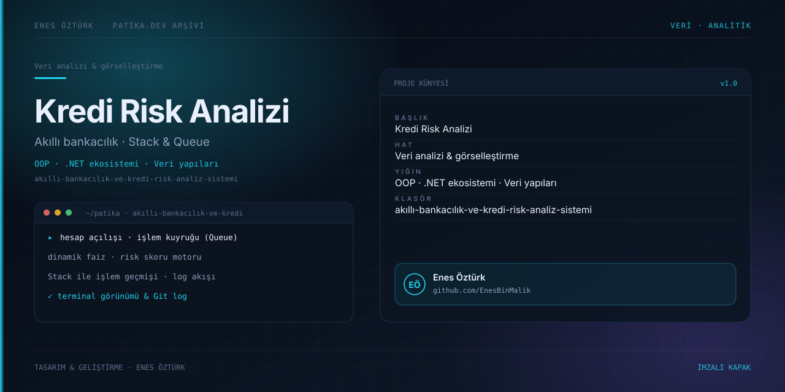

# Akıllı Bankacılık ve Kredi Risk Analiz Sistemi



> **Patika.dev arşivi · Bankacılık · veri yapıları** — tasarım ve geliştirme: **Enes Öztürk**

---

Hesap işlemlerini Stack/Queue veri yapılarıyla yürüten, dinamik faiz ve risk skoru üreten akıllı bankacılık simülatörü.

## Öne çıkanlar

- **Modül 1 — hesaplar** — açılış, bakiye ve hareketler.
- **Modül 2 — veri yapıları** — işlem kuyruğu (Queue) ve geçmiş yığını (Stack).
- **Modül 3 — kredi risk motoru** — dinamik faiz, limit ve risk skoru.
- **Modül 4 — loglama** — Git destekli dosya kaydı ve terminal görünümü.
- Mimari görünümü ve LinkedIn paylaşım kartı.

## Teknoloji

React · TypeScript · Vite. Her klasör kendi `package.json`'ına sahip bağımsız bir projedir; kök dizinde kurulum yapılmaz.

## Kurulum ve çalıştırma

```bash
cd "akıllı-bankacılık-ve-kredi-risk-analiz-sistemi"
npm install
npm run dev
```

| Komut | Not |
| --- | --- |
| `npm install` | bağımlılıklar |
| `npm run dev` | http://localhost:3000 |
| `npm run build` | üretim derlemesi |
| `npm run lint` | tsc --noEmit |

## Proje yapısı

```
akıllı-bankacılık-ve-kredi-risk-analiz-sistemi/
├── index.html
├── package.json
├── docs/cover.svg            # imza kapak
└── src/
    ├── App.tsx               # ekranların birleştiği yer
    ├── main.tsx
    ├── components/
    ├── data/
    ├── services/
    └── types/
```

## Lisans

Ödev ve portföy amaçlı çalışma; tüm hakları **Enes Öztürk**'e aittir.
