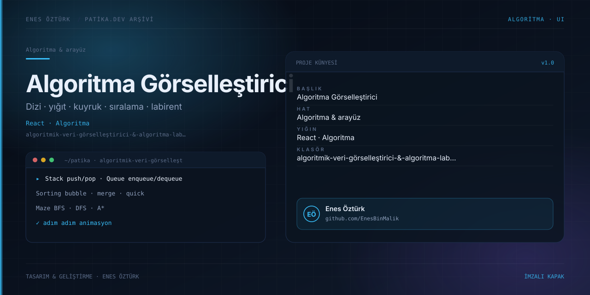

# Algoritmik Veri Görselleştirici & Algoritma Labirenti



> **Patika.dev arşivi · Algoritma & veri yapıları** — tasarım ve geliştirme: **Enes Öztürk**

---

Dizi, yığıt, kuyruk, sıralama ve labirent keşfi algoritmalarını adım adım izleyerek öğreten interaktif simülatör.

## Öne çıkanlar

- **Dizi görselleştirici** — ekleme, silme ve erişim adımları.
- **Yığıt & kuyruk** — push/pop ve enqueue/dequeue animasyonları.
- **Sıralama** — bubble, merge ve quick sort adım karşılaştırması.
- **Labirent** — BFS, DFS ve A* ile yol bulma.
- Modül başına bağımsız ekran ve kontrol paneli.

## Teknoloji

React · TypeScript · Vite. Her klasör kendi `package.json`'ına sahip bağımsız bir projedir; kök dizinde kurulum yapılmaz.

## Kurulum ve çalıştırma

```bash
cd "algoritmik-veri-görselleştirici-&-algoritma-labirenti"
npm install
npm run dev
```

| Komut | Not |
| --- | --- |
| `npm install` | bağımlılıklar |
| `npm run dev` | http://localhost:3000 |
| `npm run build` | üretim derlemesi |

## Proje yapısı

```
algoritmik-veri-görselleştirici-&-algoritma-labirenti/
├── index.html
├── package.json
├── docs/cover.svg            # imza kapak
└── src/
    ├── App.tsx               # ekranların birleştiği yer
    ├── main.tsx
    ├── components/
    ├── modules/
    └── types/
```

## Lisans

Ödev ve portföy amaçlı çalışma; tüm hakları **Enes Öztürk**'e aittir.
