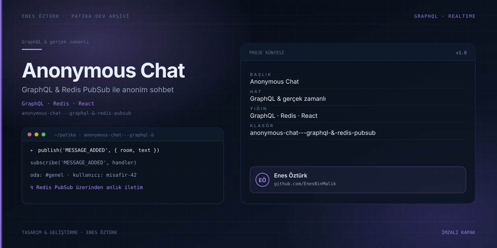

# Anonymous Chat — GraphQL + Redis PubSub



> **Patika.dev · GraphQL patikası — Proje 3: Anonim Sohbet** · Enes Öztürk

## Ne yapıyor?

Gerçek bir GraphQL sunucusu ve WebSocket abonelikleriyle çalışan, kimlik gerektirmeyen oda sohbeti.
Mesajlar **anonim takma adlarla** (rastgele hayvan adı + renk + emoji avatar) gönderilir; bir sekmeye
yazılan mesaj diğer sekmelere `messageAdded` aboneliği üzerinden anında düşer. Yazıyor… göstergesi ve
beğeni sayacı da abonelikle yayılır.

## Mimari

| Katman | Gerçek durum |
| --- | --- |
| HTTP | Express 4 · `POST /graphql` (`server.ts:25`) · `GET /api/status` (`:49`) · `GET /api/schema` (`:62`) |
| Gerçek zamanlı | `graphql-ws` + Node `ws` (`server.ts:7-8`), aynı 3000 portu upgrade eder |
| Şema | SDL string + `@graphql-tools/schema` (`server/schema.ts:110-177`, `makeExecutableSchema` `:376`) |
| PubSub | `RedisPubSub` (`graphql-redis-subscriptions`), yayıncı/abone `ioredis` |
| **Redis yoksa** | `REDIS_URL` tanımlı değilse `ioredis-mock` bellek içine düşer (`server/redis.ts:29-34`) — kurulum gerektirmeden çalışır |
| Depolama | **Bellek içi dizi**: `const messages: Message[]` (`schema.ts:67`) ve `roomsMap` (`:65`), 500 mesajda bir eski kayıtlar atılır (`:249-251`). Veritabanı yok; sunucu yeniden başlatılınca sohbet silinir |

## Şema

```graphql
type Query      { messages(roomId: String, limit: Int): [Message!]!
                  rooms: [Room!]!  stats: ServerStats!  redisInfo: String! }

type Mutation   { sendMessage(content: String!, author: String!, avatar: String, color: String,
                               roomId: String, replyToId: String, replyToContent: String,
                               replyToAuthor: String): Message!
                  likeMessage(id: ID!): Message!
                  setTyping(roomId: String!, author: String!, isTyping: Boolean!): TypingStatus!
                  createRoom(id: String!, name: String!, description: String!, icon: String): Room!
                  clearRoomMessages(roomId: String!): Boolean! }

type Subscription { messageAdded(roomId: String): Message!
                    messageLiked(roomId: String): Message!
                    userTyping(roomId: String): TypingStatus! }
```

İstemci tarafı: sorgu ve mutasyonlar `fetch('/graphql')` ile gidiyor (`src/lib/graphqlClient.ts:161`),
abonelikler `graphql-ws` `createClient` ile (`:201`). `messageAdded` aboneliği `roomId` değişkenine göre
filter fonksiyonuyla süzüyor (`schema.ts:340-346`).

## Kurulum ve çalıştırma

```bash
npm install
npm run dev                 # tsx server.ts → http://localhost:3000 (API + arayüz tek portta)

# isteğe bağlı: gerçek Redis ile
docker run -d -p 6379:6379 redis:7
REDIS_URL=redis://localhost:6379 npm run dev
```

`npm start` aynı sunucuyu başlatır. `npm run build` arayüzü derler; `npm run preview` **abonelikleri
servis etmez** (WS dahil değil). `npm run clean` Windows'ta çalışmaz (`rm -rf`).

Gerçek Redis'e bağlanıp bağlanmadığını anlamanın yolu: `GET /api/status` → `redis.mode` alanı.

## Proje yapısı

```
anonymous-chat---graphql-&-redis-pubsub/
├── server.ts                 # Express + graphql-ws + Vite middlewareMode
├── server/{schema,redis}.ts  # SDL + resolver'lar, RedisPubSub kurulumu
├── src/
│   ├── App.tsx               # oda seçimi, mesaj listesi, abonelik yönetimi (424 satır)
│   ├── lib/graphqlClient.ts  # fetch + graphql-ws istemcisi
│   ├── lib/{avatars,audio}.ts
│   └── components/           # Sidebar, MessageList, MessageInput, CreateRoomModal,
│                              ProfileModal, Header, GraphQLInspectorModal
└── docs/cover.svg
```

## Bilinen kısıtlar ve yapılacaklar

- [ ] **`redisInfo.connected` her zaman `true` dönüyor** (`server/redis.ts:41`) — mock modda da "bağlı"
      gösterir; `connected: !isMock` olmalı ve arayüz mock modunu ayrı etiketlemeli.
- [ ] Mesajlar yalnız süreç boyunca yaşıyor; kalıcılık için Redis veri yapısı, Mongo veya SQLite eklenmeli.
- [ ] Anonim kimlik istemcide üretiliyor ve imzalanmıyor — aynı kişi kendini tekrar tekrar "başkası"
      olarak tanıtabilir; bu bir sohbet ürünü için güvenlik, bir ödev için not konusu.
- [ ] `/api/schema` uç noktası SDL'i elle yazılmış metin olarak dönüyor (`server.ts:62+`) — `printSchema(schema)`
      ile otomatikleştirilmeli; yoksa iki kopya birbirinden sapıyor.
- [ ] `graphql ^17.0.2`, `typescript ^7.0.2`, `vite ^8.3.0` gibi var olmayan sürüm aralıkları bildiriliyor;
      `@google/genai`, `dotenv`, `motion`, `autoprefixer` kullanılmıyor.
- [ ] `ioredis` kurulumunda `retryStrategy: () => null` olduğu için ilk hatada deneme bırakılıyor —
      hata yalnız konsola uyarı olarak düşüyor, arayüzde gösterilmiyor.
- [ ] Abonelik temizliği (unsubscribe) ve yeniden bağlanma davranışı test edilmeli.

## Lisans

Ödev amaçlı çalışma; Enes Öztürk'e ait.
