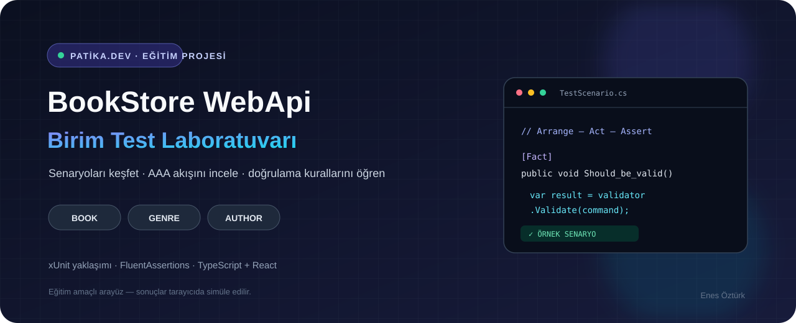

<div align="center">
  

  <p><strong>Book • Genre • Author</strong> · xUnit yaklaşımı · Senaryo simülatörü</p>
</div>

# BookStore WebApi — Birim Test Laboratuvarı

BookStore WebApi ödevindeki Book, Genre ve Author işlemlerini; test senaryolarını, doğrulama kurallarını ve Arrange–Act–Assert akışını incelemek için hazırlanmış etkileşimli bir eğitim arayüzü.

> **Önemli:** Arayüzdeki test koşucusu ve senaryo laboratuvarı tarayıcı içinde örnek sonuçları simüle eder; gerçek bir .NET test süreci başlatmaz. İndirilen ZIP de eğitim amaçlı örnek dosyalardan oluşur. Çıktıları kendi WebApi projenizle eşleştirin ve `dotnet test` ile ayrıca doğrulayın. Proje, derleme veya test kapsamı için doğrulanmış başarı iddiasında bulunmaz.

## İçindekiler

- [Özellikler](#özellikler)
- [Teknolojiler](#teknolojiler)
- [Yerel çalıştırma](#yerel-çalıştırma)
- [Proje yapısı](#proje-yapısı)
- [Sınırlar ve doğrulama](#sınırlar-ve-doğrulama)

## Özellikler

- **Test Koşucusu:** Book, Genre ve Author kategorilerinde örnek senaryo listesi, arama ve filtreleme.
- **Kod Gezgini:** Eğitim amaçlı xUnit/FluentAssertions örneklerini inceleme, kopyalama ve indirme.
- **Senaryo Laboratuvarı:** Form girdileriyle bazı başarılı ve hatalı durumların istemci tarafında canlandırılması.
- **Ödev Raporu:** Arayüzde gösterilen kapsam özeti ve örnek ZIP dışa aktarımı.
- **Duyarlı arayüz:** Masaüstü ve mobil ekranlara uyumlu, Türkçe içerik.

## Teknolojiler

React · TypeScript · Vite · Tailwind CSS · Lucide · JSZip

Arayüzde gösterilen örneklerin hedeflediği .NET konuları: C#, xUnit, FluentAssertions, FluentValidation ve EF Core InMemory. Bu .NET bileşenleri bu klasörde çalışan bir sunucu veya gerçek test çalıştırıcısı olarak yer almaz.

## Yerel çalıştırma

**Gereksinimler:** Node.js ve npm veya Bun.

```bash
cd "bookstore-webapi-unit-test-suite---enes-öztürk"
npm install
npm run dev
```

Bun kullanıyorsanız `bun install` ve `bun run dev` komutlarını kullanabilirsiniz. Üretim derlemesi ve yerel önizleme:

```bash
npm run build
npm run preview
```

## Proje yapısı

```text
src/
├── components/   # Koşucu, kod gezgini, senaryo simülatörü ve rapor
├── data/         # Eğitim amaçlı test senaryoları ve C# örnekleri
├── utils/        # Örnek dosyaları ZIP/tek dosya olarak dışa aktarma
├── App.tsx
└── main.tsx
```

## Sınırlar ve doğrulama

- Test listesi, süreler ve terminal görünümü arayüzdeki örnek veridir; gerçek `dotnet test` çıktısı değildir.
- Kod gezginindeki C# içeriklerini kendi .NET çözümünüz, paket sürümleriniz ve veri modellerinizle karşılaştırın.
- Gerçek testleri çalıştırmak için uyumlu .NET test projesine geçip proje kökünde `dotnet test` komutunu çalıştırın.
- Bu klasörün web uygulaması için `npm run lint` TypeScript kontrolünü, `npm run build` Vite üretim derlemesini çalıştırır.

---

**Hazırlayan:** Enes Öztürk · Patika.dev ödev çalışması
