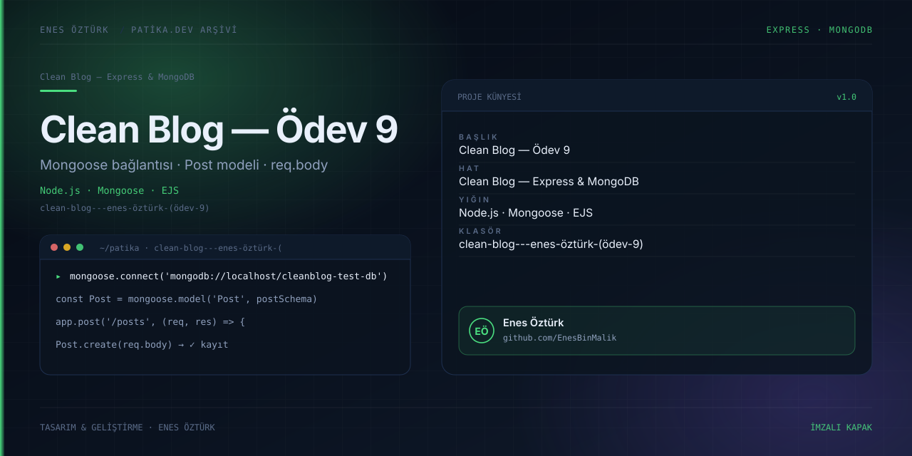

# Clean Blog — Ödev 9: Mongoose ile MongoDB'ye Bağlanmak



> **Patika.dev · Node.js patikası — Clean Blog serisi, Ödev 9** · Enes Öztürk
> Seri: [ödev-7 Express](../clean-blog---ödev-7) → **[ödev-9 (burada)](../clean-blog---enes-öztürk-(ödev-9))** → [ödev-10 routing](../clean-blog---ödev-10-(enes-öztürk)) → [ödev-11 MVC](../clean-blog---ödev-11-(mvc,-update-&-delete)) → [ödev-12 dağıtım](../clean-blog---ödev-12-(bölüm-6))

## Ödevin çıktısı

Seride ilk kez **veritabanı ve kalıcı kayıt** var: Mongoose ile `cleanblog-test-db` veritabanına
bağlanılıyor, `Post` modeli tanımlanıyor ve `/api/posts` üzerinde Create / Read / Delete çalışan bir
REST API kuruluyor. Ödevin odak noktası `express.urlencoded()` + `req.body` okuma (`server.ts:101`).

Bu ödeve göre eklenenler:
- `src/models/Post.ts` — şema ve `IPostDocument` arayüzü
- `src/services/api.ts` — istemci tarafı fetch sarmalayıcısı + localStorage aynası
- `server.ts` — 6 uç nokta ve MongoDB bağlantı denemesi

## Veri modeli

```ts
// src/models/Post.ts:16-35
{ title: String (required), detail: String (required),
  author: String (required), dateCreated: Date (default Date.now) }
```

İstemci tipi `IPost` (`src/types.ts:1-7`), tohum kayıtlar `server.ts:45-70` içinde 3 doküman.

## API

| Yol | İşlev | Konum |
| --- | --- | --- |
| `GET /api/posts` | Listeleme (Mongo → yoksa bellek) | `server.ts:106` |
| `GET /api/posts/:id` | Tekil getiri | `server.ts:124` |
| `POST /api/posts` | Oluşturma, `req.body`'den alan | `server.ts:142` |
| `DELETE /api/posts/:id` | Silme | `server.ts:180` |
| `POST /api/posts/reset` | Tohum veriyi geri yükle | `server.ts:194` |
| `GET /api/status` | Bağlantı/kip bilgisi | `server.ts:215` |

**Güncelleme (PUT/PATCH) bu ödevde yok** — seri ödev-11'de tamamlanıyor.

## Kurulum ve çalıştırma

```bash
npm install

# MongoDB (Docker ile hızlı kurulum)
docker run -d -p 27017:27017 mongo:7

MONGODB_URI="mongodb://localhost:27017/cleanblog-test-db" npm run dev
# http://localhost:3000  → API ve arayüz aynı portta (Vite middlewareMode)
```

MongoDB kapalıysa sunucu 2500 ms sonra **sessizce** bellek içi diziye düşüyor (`server.ts:73`);
konsolda "Yerel MongoDB servisi çevrimdışı" uyarısı görünür (`:36`).

curl ile deneme:

```bash
curl -X POST http://localhost:3000/api/posts \
  -H 'Content-Type: application/json' \
  -d '{"title":"Deneme","detail":"govde","author":"Enes"}'

curl http://localhost:3000/api/status
```

## Dürüstlük notları

- `Navbar.tsx:167-171` "Database · cleanblog-test-db · Mongoose Modeli Aktif" rozetini **koşulsuz**
  basıyor; MongoDB kapalıyken bile rozet "aktif" görünür. Durumun gerçek kaynağı `GET /api/status` ve
  o uç `src/services/api.ts:145` içinde tanımlı olmasına rağmen **hiç çağrılmıyor**.
- `DELETE /api/posts/:id` (`:183`) Mongo kipinde de önce bellek içi diziyi değiştiriyor; iki kip arasında
  kimlik tutarsızlığı oluşabiliyor (`GET /api/posts/:id` önce Mongo, sonra bellek deniyor `:127-134`).
- `GET /api/homework-code` (`:269-401`) farklı bir EJS'li çözüm metni döndürüyor ve `views/*.ejs`
  dosyaları klasörde yok.
- README AI Studio şablonuydu; `MONGODB_URI` ve Mongoose'dan hiç söz etmiyordu.

## Yapılacaklar

- [ ] Rozeti `/api/status` sonucuna bağla; mock/in-memory kipini ayrı renk ve metinle göster.
- [ ] Güncelleme uçunu ekle (`PUT /api/posts/:id`) — ödev-11'in React tarafı bunu taklit ediyor ama
      sunucu hâlâ yok.
- [ ] `MONGODB_URI` için `.env.example` ve `dotenv` yüklemesi ekle; bağlantı hatasında süreci ya
      düşür ya da görünür hata ver.
- [ ] Silme işlemini tek depo kaynağı üzerinden yürüt (Mongo varsa bellek dizisini değiştirme).
- [ ] Kullanılmayan bağımlılıklar: `@google/genai`, `motion`, `esbuild`, `autoprefixer`.
- [ ] `npm run clean` Windows'ta çalışmıyor (`rm -rf`).

## Lisans

Ödev amaçlı çalışma; Enes Öztürk'e ait.
