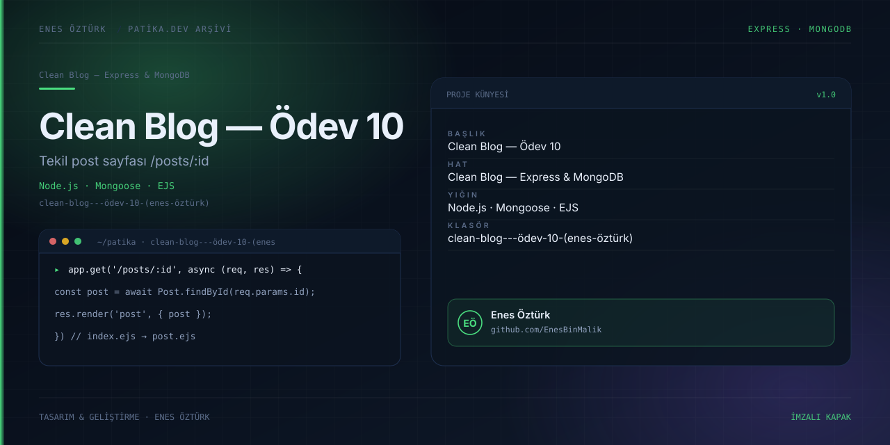

# Clean Blog — Ödev 10: Tekil Post Sayfası ve Yönlendirme



> **Patika.dev · Node.js patikası — Clean Blog serisi, Ödev 10** · Enes Öztürk
> Seri: [ödev-7 Express](../clean-blog---ödev-7) → [ödev-9 MongoDB](../clean-blog---enes-öztürk-(ödev-9)) → **[ödev-10 (burada)](../clean-blog---ödev-10-(enes-öztürk))** → [ödev-11 MVC](../clean-blog---ödev-11-(mvc,-update-&-delete)) → [ödev-12 dağıtım](../clean-blog---ödev-12-(bölüm-6))

## Ödevin çıktısı

Listeden **tekil yazı sayfasına geçiş** (`/posts/:id`) ve bu geçizin arayüzde çalışır hâli. Bu klasörde
sunucu **yok**: yönlendirme `window.location.hash` ile taklit ediliyor, veri ise `localStorage`'da tutuluyor.
Derste işlenen Express/EJS çözümü (`app.get('/posts/:id', … → res.render('post'))`) yalnızca
`src/data/homeworkCode.ts` içindeki kod görüntüleyicide metin olarak sergileniyor.

## Yönlendirme tablosu (`App.tsx:53-99`)

| Hash | Görünüm |
| --- | --- |
| `#/` (boş) | Yazı listesi |
| `#/posts/:id` | `PostDetail` — tekil sayfa |
| `#/add_post` | `AddPost` formu |
| `#/about` | `AboutView` |
| `#/homework` | Ders kodu görüntüleyici |

`hashchange` dinleyicisi `App.tsx:54-82` içinde kurulu; gezinme `window.location.hash = …` atamalarıyla
yapılıyor (`:90-99`). Gerçek bir router (`react-router`) yok, dolayısıyla URL paylaşımı ve tarayıcı
ileri/geri davranışı sınırlı.

## Veri

```ts
// src/types/blog.ts:1-8
{ _id: string, title?: string, subtitle?: string, detail: string,
  dateCreated: string, author: string }
```

- 4 tohum yazı: `src/data/initialPosts.ts:3-36`.
- `dateCreated` **metinsel** ("29 Ekim 2026", `initialPosts.ts:9`) — sıralama/tarih biçimlendirme yapılamaz.
- Kimlikler `generateMongoId()` ile 24 haneli rastgele hex olarak üretiliyor (`App.tsx:17-23`); MongoDB
  çıktısına benziyor ama Mongo ile ilgisi yok.
- Kalıcılık: `localStorage` anahtarı `clean_blog_posts_v1` (`App.tsx:14`). Ekleme `:114`, silme `:139`,
  sıfırlama `:146`.

## Çalıştırma

```bash
npm install
npm run dev          # vite --port=3000 --host=0.0.0.0 → http://localhost:3000
```

`npm run build` / `npm run preview` arayüzü derler ve servis eder. `npm run lint` = `tsc --noEmit`.
`npm run clean` Windows'ta çalışmaz (`rm -rf`).

## Serideki yeri ve gerileme

Ödev-9'daki Mongoose + REST API bu klasörde **yeniden kurulmadı**; klasör yalnız istemci tarafı bir SPA.
`package.json` hâlâ `express`, `@types/express`, `tsx`, `dotenv`, `@google/genai`, `motion` bildiriyor ama
kodda tek bir `fetch` yok — 6 ölü bağımlılık.

## Dürüstlük notları

- Arayüz banner'ı (`App.tsx:161-165`) ödevi `/posts/:id` sunuyormuş gibi anlatıyor; fiilen `#/posts/:id`.
- `metadata.json` "index.ejs, app.js ve post.ejs entegrasyonu" diyor; bu klasörde EJS motoru veya
  `.ejs` dosyası yok.
- `STORAGE_KEY = 'clean_blog_posts_v1'` **ödev-12 ile aynı anahtar** ve alan adları farklı
  (burada `_id`, ödev-12'de `id`) — aynı tarayıcıda 3000 portunda açılırsa iki proje birbirinin verisini okur.
- `useEffect` hash dinleyicisinin bağımlılık listesi `[posts]` (`App.tsx:82`); her veri değişiminde
  dinleyici yeniden kuruluyor.

## Yapılacaklar

- [ ] `react-router` ekleyip gerçek yollarla (`/posts/:id`) çalışır hâle getir.
- [ ] `dateCreated` alanını `Date`/ISO metne çevir; liste sıralamasını tarihe göre yap.
- [ ] Depolama anahtarını proje adına göre ayır (`clean_blog_odev10_posts`).
- [ ] Ödev-9'un Express tarafını geri ekle (veya README'de "istemci prototipi" de) ve ölü bağımlılıkları sil.
- [ ] Hash dinleyicisini `[]` bağımlılıkla kur, güncel `posts` için `useRef`/fonksiyonel state kullan.

## Lisans

Ödev amaçlı çalışma; Enes Öztürk'e ait.
