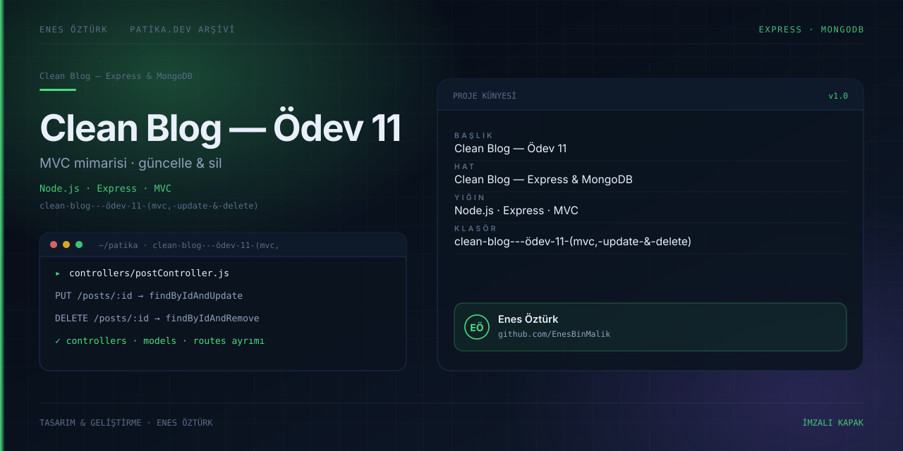

# Clean Blog — Ödev 11: MVC Mimarisi, Güncelleme ve Silme



> **Patika.dev · Node.js patikası — Clean Blog serisi, Ödev 11** · Enes Öztürk
> Seri: [ödev-7 Express](../clean-blog---ödev-7) → [ödev-9 MongoDB](../clean-blog---enes-öztürk-(ödev-9)) → [ödev-10 routing](../clean-blog---ödev-10-(enes-öztürk)) → **[ödev-11 (burada)](../clean-blog---ödev-11-(mvc,-update-&-delete))** → [ödev-12 dağıtım](../clean-blog---ödev-12-(bölüm-6))

## Ödevin çıktısı

İki şey: **(1) tam CRUD** — ödev-10'un ekleme/görüntüleme/silme üçlüsüne **güncelleme** ekleniyor
(`EditPostView` + `handleSaveUpdatedPost`, `App.tsx:85`), silme onay modalı ve toast ile
tamamlanıyor; **(2) MVC anlatısı** — model/view/controller dosyalarının nasıl bölündüğünü gösteren
bir gezgin (`MvcExplorerView`).

## CRUD akışı

| İşlem | Fonksiyon | Konum |
| --- | --- | --- |
| Create | `handleAddPost` | `App.tsx:129` |
| Read (liste + tekil) | hash yerine state tabanlı görünüm | `App.tsx` ActivePage |
| Update | `handleSaveUpdatedPost` | `App.tsx:85` + `EditPostView.tsx` |
| Delete | `DeleteConfirmModal` + `Toast` | `App.tsx:106-126` |
| Reset | `handleResetData` | `App.tsx:143` |

## Veri modeli (`src/types/index.ts:1-13`)

```ts
{ _id, title, subtitle, detail, author, authorAvatar?,
  category, imageUrl, dateCreated, readTimeMinutes, likes }
```

Ödev-10'a göre eklenen alanlar: `category`, `imageUrl`, `readTimeMinutes`, `likes`.
Kalıcılık: `localStorage` anahtarı `clean_blog_odev11_posts` (`App.tsx:23`). Tohum veri 4 yazı
(`src/data/initialPosts.ts`).

## MVC dosyaları nerede?

`src/data/mvcCodeFiles.ts:3-479` içinde yedi **kod metni** duruyor; arayüz bunları sekmeli bir görüntüleyicide
gösteriyor. Diskte `controllers/`, `models/`, `views/` klasörleri yok ve hiçbir dosya çalıştırılmıyor:

| Gösterilen dosya | Satır |
| --- | --- |
| `views/post.ejs` | `mvcCodeFiles.ts:5` |
| `views/edit.ejs` | `:83` |
| `controllers/postController.js` | `:175` |
| `controllers/pageController.js` | `:269` |
| `models/Post.js` | `:315` |
| `app.js` | `:367` |
| `views/partials/_footer.ejs` | `:440` |

Anlatılan desen: `method-override` ile `?_method=PUT` / `?_method=DELETE` taşıyan HTML formları ve
`postController.updatePost` / `deletePost` fonksiyonları.

## Çalıştırma

```bash
npm install
npm run dev          # vite --port=3000 --host=0.0.0.0 → http://localhost:3000
```

`npm run build` / `preview` çalışır; `lint` = `tsc --noEmit`; `clean` Windows'ta çalışmaz (`rm -rf`).

## Dürüstlük notları

- Toast metinleri HTTP trafiği uyduruyor: `App.tsx:93-97` "PUT /posts/… → postController.updatePost
  başarıyla çalıştırıldı", `:121-125` "DELETE /posts/…?_method=DELETE". Ortada sunucu, `fetch` çağrısı
  veya veritabanı yok; olan şey React state + `localStorage` yazması.
- `imageUrl` alanı harici `images.unsplash.com` bağlantıları içeriyor (`initialPosts.ts:22`) — çevrimdışı
  kırılır ve kaynak lisansı kontrol edilmemiş.
- `App.tsx:61-63` içindeki 4000 ms'lik toast temizleme `setTimeout`'u unmount'ta iptal edilmiyor.
- `@google/genai`, `express`, `@types/express`, `tsx`, `dotenv`, `motion` bildirili ama kullanılmıyor.
- Arayüz metinleri Türkçe, tanımlayıcılar İngilizce karışık; `ActivePage` değerleri `'post-detail'`
  gibi tireli sabitler — tutarlı bir isimlendirme haritası yok.

## Yapılacaklar

- [ ] MVC kodunu **gerçek dosyalara** çıkar (`controllers/`, `models/`, `views/`) ve `npm run dev:api`
      gibi ayrı bir Express süreciyle çalıştır; arayüz sonra `PUT`/`DELETE` atabilir.
- [ ] Toast metinlerini "taslak: PUT /posts/:id" gibi niyet belirten biçime çevir ya da gerçekten isteği at.
- [ ] Toast zamanlayıcısını `useEffect` temizliğine al.
- [ ] Görselleri `src/assets/` altına indir ve yerelden servis et.
- [ ] `clean_blog_odev11_posts` şemasını `title?` zorunluluğu gibi tutarlı alan tipleriyle sıkılaştır ve
      `initialPosts` ile ödev-12/ödev-10 anahtar çakışmasını kontrol et.
- [ ] Ölü bağımlılıkları ve `package.json` adını (`react-example`) düzelt.

## Lisans

Ödev amaçlı çalışma; Enes Öztürk'e ait.
