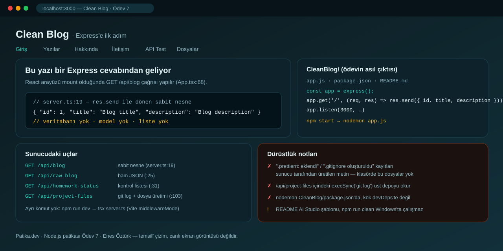

# Clean Blog — Ödev 7: Express ile İlk Sunucu



> **Patika.dev · Node.js patikası — Clean Blog serisi, Ödev 7** · Enes Öztürk
> Seri: [ödev-7 (burada)](../clean-blog---ödev-7) → [ödev-9 MongoDB](../clean-blog---enes-öztürk-(ödev-9)) → [ödev-10 routing](../clean-blog---ödev-10-(enes-öztürk)) → [ödev-11 MVC](../clean-blog---ödev-11-(mvc,-update-&-delete)) → [ödev-12 dağıtım](../clean-blog---ödev-12-(bölüm-6))

## Ödevin çıktısı

Bu klasörde iki şey var:

1. **`CleanBlog/`** — ödevin asıl teslimi. Bağımsız bir Express uygulaması: `app.js` içinde
   `app.get('/')` istemcisine `{ id: 1, title: 'Blog title', description: 'Blog description' }`
   nesnesini `res.send` ile döndürüyor, `app.listen(3000)` ile ayağa kalkıyor, `npm start` nodemon ile
   çalışıyor.
2. **Üst klasördeki React arayüzü** — o tek uç noktasını çeken ve ödevin kontrol listesini gösteren
   sunum katmanı. Yazı listesi, model veya veritabanı **bu ödevde yok**.

## Çalıştırma

Asıl teslim (Express):

```bash
cd CleanBlog
npm install
npm start            # nodemon app.js → http://localhost:3000
curl http://localhost:3000/
```

Sunum arayüzü (kök klasör):

```bash
npm install
npm run dev          # tsx server.ts → http://localhost:3000 (Vite middlewareMode, server.ts:128-135)
```

> İki uygulama da 3000 portunu kullanır; aynı anda çalıştırmak için birinin portunu değiştir.

## Arayüzün çektiği uçlar

| Yol | Ne döner | Konum |
| --- | --- | --- |
| `GET /api/blog` | `{ id: 1, title, description }` sabit nesne | `server.ts:19` |
| `GET /api/raw-blog` | Ham JSON | `server.ts:25` |
| `GET /api/homework-status` | Kontrol listesi kayıtları | `server.ts:31` |
| `GET /api/project-files` | `git log` çıktısı + listelenen dosyalar | `server.ts:103` |

## Teknoloji

React 19 · TypeScript · Vite 8 · Tailwind v4 · Express 4 · nodemon (yalnız `CleanBlog/`)

## Dürüstlük notları (bu ödevde ne yok)

- `server.ts:67-71` ".prettierrc eklendi", `:93-95` ".gitignore oluşturuldu, ilk commit atıldı"
  kayıtları döndürüyor; oysa `CleanBlog/` klasöründe yalnız `app.js`, `package.json`, `README.md` var —
  ne `.prettierrc` ne `.gitignore` mevcut. `App.tsx:117-120` bu dosyaların içeriğini **ekranda göstermek
  için üretiyor**.
- `server.ts:37` `execSync('git log -1 …')` çağrısı **üst depoda** çalışıyor; yani arayüzün "son commit"i
  bu ödevin değil, deponun en son commit'ini gösterir.
- `nodemon` `CleanBlog/package.json` içinde tanımlı, kök `devDependencies`'te yok.
- README AI Studio şablonuydu; bu dosya ödevi anlatıyor. `npm run clean` hâlâ Windows'ta çalışmıyor.

## Yapılacaklar

- [ ] `CleanBlog/` içine gerçek `.gitignore` ve `.prettierrc` ekle (iddia değil, dosya).
- [ ] `app.get('/')` yerine `app.get('/api/blog')` gibi tutarlı bir yol kullan ve README'deki curl ile eşleştir.
- [ ] İki uygulamanın portunu ayır (ör. API 4000, arayüz 3000) veya arayüzü tek Express sürecine taş.
- [ ] `execSync`'i ya kaldır ya da `cwd`'yi ödev klasörüne sabitle.
- [ ] Kullanılmayan bağımlılıkları temizle: `@google/genai`, `motion`, `dotenv`.

## Lisans

Ödev amaçlı çalışma; Enes Öztürk'e ait.
