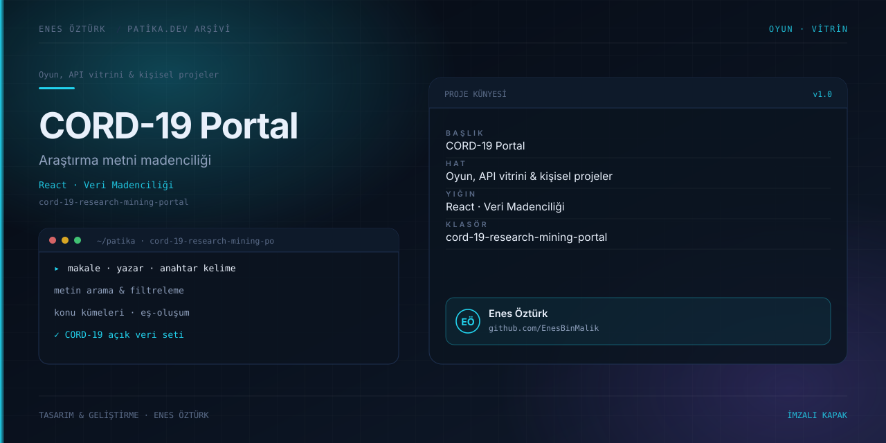

# CORD-19 Research Mining Portal



> **Patika.dev arşivi · Veri madenciliği** — tasarım ve geliştirme: **Enes Öztürk**

---

COVID-19 açık araştırma veri setini (CORD-19) konu, yazar ve anahtar kelime üzerinden taramaya açan keşif portalı.

## Öne çıkanlar

- Makale, yazar ve anahtar kelime araması.
- Konu kümeleri ve terim eş-oluşum görünümü.
- Filtre paneli ve sonuç kartları.
- Araştırma özetini tek ekranda toplayan pano.

## Teknoloji

React · TypeScript · Vite. Her klasör kendi `package.json`'ına sahip bağımsız bir projedir; kök dizinde kurulum yapılmaz.

## Kurulum ve çalıştırma

```bash
cd "cord-19-research-mining-portal"
npm install
npm run dev
```

| Komut | Not |
| --- | --- |
| `npm install` | bağımlılıklar |
| `npm run dev` | http://localhost:3000 |
| `npm run build` | üretim derlemesi |

## Proje yapısı

```
cord-19-research-mining-portal/
├── index.html
├── package.json
├── docs/cover.svg            # imza kapak
└── src/
    ├── App.tsx               # ekranların birleştiği yer
    ├── main.tsx
    ├── assets/
    ├── components/
    ├── data/
    └── services/
```

## Lisans

Ödev ve portföy amaçlı çalışma; tüm hakları **Enes Öztürk**'e aittir.
