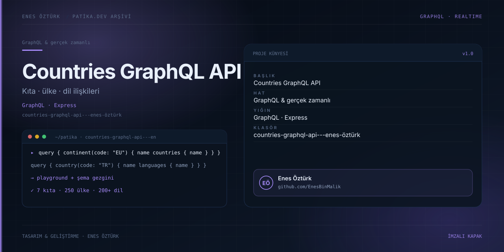

# Countries GraphQL API



> **Patika.dev · Node.js & GraphQL patikası** · Enes Öztürk
> Express üzerinde çalışan gerçek bir GraphQL sunucusu + tarayıcıdan sorgu atmayı sağlayan inceleme arayüzü.

## Genel bakış

`server.ts` gerçek bir HTTP GraphQL sunucusu ayağa kaldırır (`graphql-js`, Apollo yok). Aynı port hem
API'yi hem de Vite arayüzünü servis eder; arayüzdeki **GraphQL Studio** sekmesi `POST /graphql`'e istek
atarken, sunucu kapalıysa `src/graphql/executor.ts:12` sorguyu bellek içinden (`executeSchema`) çalıştırır.

Veri ağdalı ama küçüktür ve depoya gömülüdür: `src/graphql/data.ts` içinde **51 ülke, 7 kıta, 38 dil**.
Dış API çağrısı yoktur.

## Çalıştırma

```bash
npm install
npm run dev            # tsx server.ts → http://localhost:3000
```

Açıldıktan sonra:

| Adres | Açıklama |
| --- | --- |
| `http://localhost:3000` | İnceleme arayüzü (Studio · Veri Gezgini · Şema · API Rehberi) |
| `POST http://localhost:3000/graphql` | Sorgu uç noktası (`server.ts:52`) |
| `GET http://localhost:3000/graphql` | Tarayıcıdan deneme (query string ile, `server.ts:77`) |

Örnek istek:

```bash
curl -s http://localhost:3000/graphql \
  -H 'Content-Type: application/json' \
  -d '{"query":"{ countries(filter:{ continent:{ in:[\"EU\",\"AS\"] } }) { name capital languages { code name } } }"}'
```

Diğer betikler: `npm run build`, `npm run preview`, `npm run lint` (`tsc --noEmit`).
`npm run clean` POSIX `rm -rf` kullandığı için Windows'da başarısız olur; depoda olmayan bir `server.js`'yi
hedefler. `npm start` da çalışmaz: `node server.ts` TypeScript'i doğrudan çalıştıramaz.

## Şema

Tip ve alanlar programmatic `GraphQLObjectType` ile tanımlandı (`src/graphql/schema.ts`), SDL dosyası yok.

| Tip | Tanım satırı |
| --- | --- |
| `Language` | `schema.ts:68` |
| `Continent` | `schema.ts:90` |
| `Country` | `schema.ts:107` |

 Sorgular: `countries` (`:144`), `country` (`:166`), `continents` (`:178`), `continent` (`:192`),
 `languages` (`:204`), `language` (`:218`).

**Mutation yoktur — API salt okunurdur** (`schema.ts:231`).

Filtre girdileri (`schema.ts:14-46`): `StringQueryOperatorInput` (`eq`, `ne`, `in`, `nin`, `regex`) ile
`CountryFilterInput`, `ContinentFilterInput`, `LanguageFilterInput`.

İlişkiler resolver'larda dizi süzme ile kurulur — örnek: `Country.languages`, `data.ts` içindeki dil
kodlarına göre filtrelenir (`schema.ts:99`).

```graphql
query Dense {
  country(code: "TR") {
    code
    name
    native
    capital
    currency
    emoji
    continent { code name }
    languages { code name }
  }
  continents(filter: { code: { eq: "AS" } }) {
    code
    name
    countries { name }
  }
}
```

`Country` alanları: `code · name · native · phone · capital · currency · emoji · emojiU · continent ·
languages` (`schema.ts:110-136`). Filtre operatörleri `eq`, `ne`, `in`, `nin`, `regex`;
`CountryFilterInput` `code/continent/currency`, `ContinentFilterInput` ve `LanguageFilterInput` yalnız
`code` alanı kabul eder (`schema.ts:14-46`).

## Proje yapısı

```
countries-graphql-api---enes-öztürk/
├── server.ts                      # Express + graphql-js, SPA'yı da servis eder (port 3000)
├── src/
│   ├── graphql/{schema,data,executor,samples}.ts
│   ├── components/                # GraphQLStudio, DataExplorer, SchemaDocs, ApiGuide, Navbar, Footer
│   └── App.tsx                    # Sekme yönetimi
├── docs/cover.svg
└── metadata.json                  # AI Studio kalıntısı, işlevi yok
```

## Bilinen kısıtlar ve yapılacaklar

- [ ] Veri 51 ülkeyle sınırlı ve gömülü; `restcountries.com` gibi bir kaynaktan beslenme seçenek olabilir.
- [ ] `npm start` ve `npm run clean` bozuk, `npm run preview` API'yi ayağa kaldırmaz (yalnız SPA).
- [ ] Kilit dosyası `bun.lock` fakat dokümanlar `npm` kullanıyor — biri seçilip tutarlı hâle getirilmeli.
- [ ] `/api/health` (`server.ts:30`) ve `/api/schema` (`:46`) uçları arayüzden kullanılmıyor.
- [ ] `App.tsx:28` sunucu durumunu sabit `"online"` gösteriyor; gerçek `fetch` ile ölçülmeli.
- [ ] Kullanılmayan bağımlılıklar: `@google/genai`, `dotenv`, `motion`, `autoprefixer`, `esbuild`.
- [ ] Sürüm aralıkları var olmayan paketleri işaret ediyor (`typescript ^7.0.2`, `vite ^8.3.0`).
- [ ] Yorumlar İngilizce, arayüz metinleri Türkçe — tek dile çekilmeli.
- [ ] Test yok; `supertest` ile `/graphql` uç noktası için sorgu testleri eklenebilir.

## Lisans

Ödev amaçlı çalışma; Enes Öztürk'e ait.
