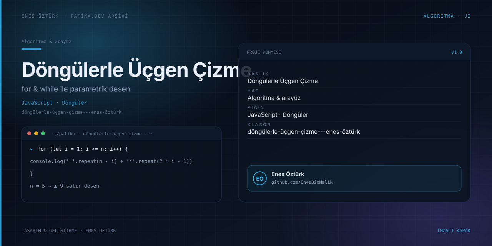

# Döngülerle Üçgen Çizimi

<div align="center">
  

  **For ve while döngüleriyle şekil üretimini keşfedin.**

  [](https://react.dev/)
  [](https://www.typescriptlang.org/)
  [](https://vite.dev/)
</div>

## Proje hakkında

Üçgen çizimini döngülerin çalışma mantığıyla birlikte anlatan etkileşimli bir eğitim arayüzü. Konsolda çıktıyı deneyebilir, adım adım izleyebilir, farklı dillerdeki örnek kodları inceleyebilir ve ödev raporuna göz atabilirsiniz.

## Öne çıkanlar

- **Etkileşimli konsol:** üçgen boyutunu değiştirerek çıktıyı gözlemleme.
- **Adım görselleştirici:** iç içe döngülerin ilerleyişini takip etme.
- **Çok dilli kod örnekleri:** JavaScript ve desteklenen diğer kod örneklerini karşılaştırma.
- **Aydınlık/koyu tema:** sistem tercihiyle başlar, başlıktan değiştirilebilir.
- **Hızlı kopyalama:** JavaScript örneğini panoya alma.

## Çalıştırma

Gereksinim: Node.js ve npm.

```bash
npm install
npm run dev
```

Vite geliştirme sunucusu varsayılan olarak `http://localhost:3000` adresinde açılır. Üretim derlemesi için `npm run build`, derlemeyi yerelde incelemek için `npm run preview` kullanın.

## Proje yapısı

```text
src/
├── App.tsx                         # Sekmeler ve ana uygulama
├── components/                     # Konsol, adım görselleştirici, kod ve rapor
└── utils/triangleGenerators.ts     # Üçgen üretimi ve kod örnekleri
docs/cover.svg                      # Proje kapağı
```

## Arşiv notu

Bu çalışma Patika.dev ödev arşivinin bir parçasıdır. Depodaki diğer projeler ve genel çalışma notları için [üst dizindeki README](../README.md)'ye bakın.

---

<div align="center">

**Enes Öztürk** · [@EnesBinMalik](https://github.com/EnesBinMalik)

*Öğrenerek üretildi; özenle imzalandı.*

</div>
