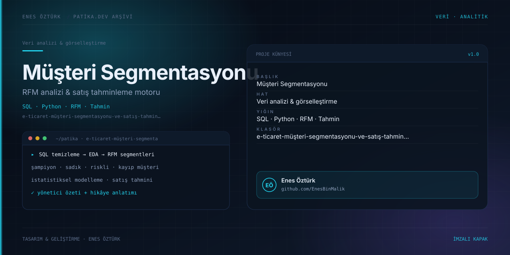

# E-Ticaret Müşteri Segmentasyonu ve Satış Tahminleme Motoru



> **Patika.dev arşivi · Veri analitiği · satış tahminleme** — tasarım ve geliştirme: **Enes Öztürk**

---

E-ticaret verisini SQL'den başlayıp RFM segmentasyonuna ve satış tahminine taşıyan uçtan uca analitik motor; dört modül hâlinde adım adım işleyen bir çalışma tezgâhı.

## Öne çıkanlar

- **Modül 1 — SQL temizleme** — ham veri, tekrarlar ve boş değerler.
- **Modül 2 — EDA & istatistik** — dağılımlar, korelasyon ve özet metrikler.
- **Modül 3 — RFM segmentasyonu & tahmin** — şampiyon, sadık, riskli, kayıp müşteri grupları.
- **Modül 4 — hikâye anlatımı** — bulguların yönetici diline çevrilmesi.
- AI analiz asistanı ve yönetici özeti raporu.

## Teknoloji

React · TypeScript · Vite. Her klasör kendi `package.json`'ına sahip bağımsız bir projedir; kök dizinde kurulum yapılmaz.

## Kurulum ve çalıştırma

```bash
cd "e-ticaret-müşteri-segmentasyonu-ve-satış-tahminleme-motoru"
npm install
npm run dev
```

| Komut | Not |
| --- | --- |
| `npm install` | bağımlılıklar |
| `npm run dev` | http://localhost:3000 |
| `npm run build` | üretim derlemesi |
| `npm run lint` | tsc --noEmit |

## Proje yapısı

```
e-ticaret-müşteri-segmentasyonu-ve-satış-tahminleme-motoru/
├── index.html
├── package.json
├── docs/cover.svg            # imza kapak
└── src/
    ├── App.tsx               # ekranların birleştiği yer
    ├── main.tsx
    ├── components/
    ├── data/
    ├── services/
    └── types/
```

## Lisans

Ödev ve portföy amaçlı çalışma; tüm hakları **Enes Öztürk**'e aittir.
