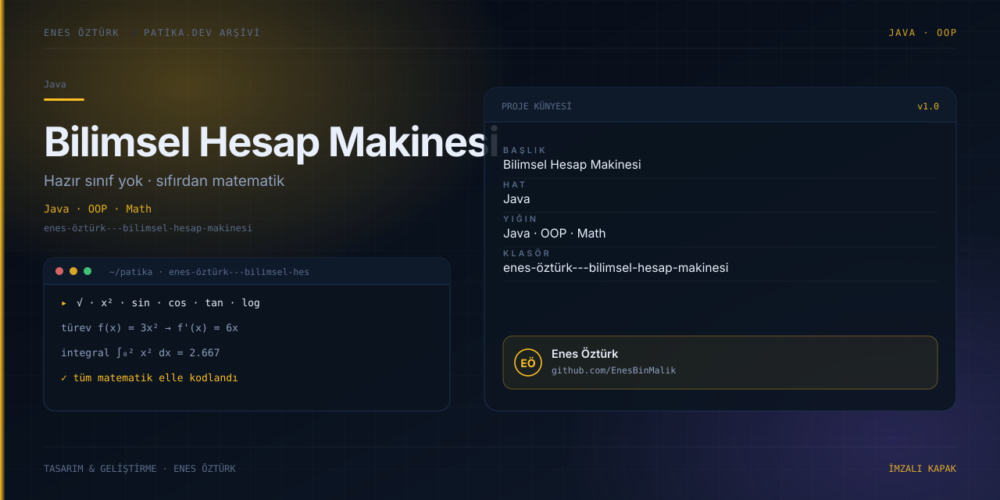

# Enes Öztürk - Bilimsel Hesap Makinesi



> **Patika.dev arşivi · Java · nesne yönelimli programlama** — tasarım ve geliştirme: **Enes Öztürk**

---

Java'nın hazır matematik sınıfları kullanılmadan, nesne yönelimli mimariyle sıfırdan yazılmış bilimsel hesap makinesi; türev ve integral adımlarını da gösterir.

## Öne çıkanlar

- Dört işlem, kuvvet, kök, logaritma ve trigonometri.
- Türev ve integral için adım adım çözüm gösterimi.
- Her işlem için üretilen Java kaynak kodunun görüntülenmesi.
- İşlem geçmişi ve hata durumları.

## Teknoloji

React · TypeScript · Vite. Her klasör kendi `package.json`'ına sahip bağımsız bir projedir; kök dizinde kurulum yapılmaz.

## Kurulum ve çalıştırma

```bash
cd "enes-öztürk---bilimsel-hesap-makinesi"
npm install
npm run dev
```

| Komut | Not |
| --- | --- |
| `npm install` | bağımlılıklar |
| `npm run dev` | http://localhost:3000 |
| `npm run build` | üretim derlemesi |

## Proje yapısı

```
enes-öztürk---bilimsel-hesap-makinesi/
├── index.html
├── package.json
├── docs/cover.svg            # imza kapak
└── src/
    ├── App.tsx               # ekranların birleştiği yer
    ├── main.tsx
    ├── components/
    ├── math/
    └── types/
```

## Lisans

Ödev ve portföy amaçlı çalışma; tüm hakları **Enes Öztürk**'e aittir.
