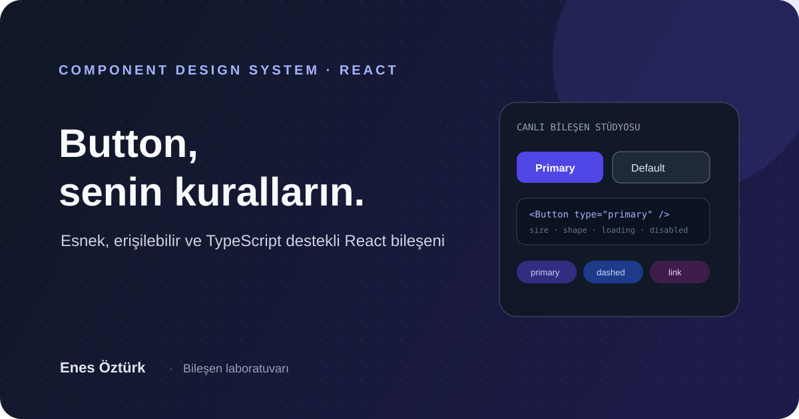

# Enes Öztürk Button

<div align="center">
  

  **Esnek ve özelleştirilebilir React Button bileşeni.**

  [](https://react.dev/)
  [](https://www.typescriptlang.org/)
  [](LICENSE)
</div>

## Proje hakkında

Beş buton çeşidini canlı olarak deneyebileceğiniz, React bileşenini ve paket yapısını inceleyebileceğiniz bir tasarım stüdyosu. Bileşen; boyut, şekil, ikon, yükleniyor, tehlike, ghost, disabled ve block durumları için örnekler sunar.

## Özellikler

- **Beş varyant:** `primary`, `default`, `dashed`, `text`, `link`.
- **Canlı stüdyo:** prop'ları değiştirip önizleme ve JSX kodunu anında üretme.
- **Paket gezgini:** package, bileşen, tipler ve README örneklerini görüntüleme.
- **TypeScript API:** `ButtonProps`, boyutlar, şekiller ve HTML button tipleri.
- **İmzalı proje arayüzü:** Enes Öztürk geliştirici imzası.

## Uygulamayı çalıştırma

Gereksinim: Node.js ve npm.

```bash
npm install
npm run dev
```

Bu klasörde `npm run dev`, Express tabanlı geliştirme sunucusunu başlatır. Tarayıcıda terminalin bildirdiği yerel adresi açın. Arayüz ve dağıtım paketi derlemesi için `npm run build` komutunu kullanın.

## Bileşeni kullanma

Paketin bu depoda üretilen arşivini `packages/enes-ozturk-button/` altında bulabilirsiniz. Paket arayüzünden arşivi indirip yerel projeye eklediğinizde örnek kullanım:

```tsx
import { Button } from 'enes-ozturk-button';

export function Actions() {
  return (
    <Button type="primary" size="large" onClick={() => console.log('Merhaba!')}>
      Devam et
    </Button>
  );
}
```

> Paket NPM'e yayınlandı varsayımı yapmayın: kurulum için önce paketin gerçekten yayınlandığını npm kayıt defterinde doğrulayın.

## Proje yapısı

```text
packages/enes-ozturk-button/  # Bileşen paketi, build betiği ve paket README'si
src/components/Button/        # Demo uygulamasındaki Button ve prop tipleri
src/App.tsx                   # Canlı stüdyo, paket gezgini ve dokümantasyon
server.ts                     # Demo sunucusu ve paket uçları
docs/cover.svg                # Proje kapağı
```

## Not

NPM yayın asistanı sunucu tarafındaki `/api/npm/publish` uç noktasına istek gönderir. Yayınlama, bu uç noktanın ve geçerli NPM erişim belirtecinin kurulmuş olmasını gerektirir. Erişim belirtecini kaynak koda veya herkese açık depoya eklemeyin.

Bu çalışma Patika.dev ödev arşivinin bir parçasıdır; genel depo haritası için [üst dizindeki README](../README.md)'ye göz atın.

---

<div align="center">

**Enes Öztürk** · [@EnesBinMalik](https://github.com/EnesBinMalik)

*Thoughtful components, signed with care.*

</div>
