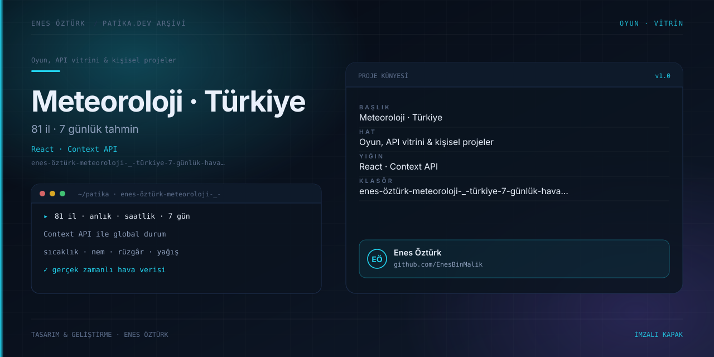

# Enes Öztürk Meteoroloji | Türkiye 7 Günlük Hava Durumu



> **Patika.dev arşivi · API entegrasyonu · Context API** — tasarım ve geliştirme: **Enes Öztürk**

---

Türkiye'nin 81 ili için anlık, saatlik ve 7 günlük hava durumunu Context API ile yöneten global durum üzerinden sunan meteoroloji uygulaması.

## Öne çıkanlar

- 81 il için anlık ve 7 günlük tahmin.
- Sıcaklık, nem, rüzgâr ve yağış olasılığı.
- Context API ile merkezî durum yönetimi.
- İl arama ve hızlı geçiş.

## Teknoloji

React · TypeScript · Vite. Her klasör kendi `package.json`'ına sahip bağımsız bir projedir; kök dizinde kurulum yapılmaz.

## Kurulum ve çalıştırma

```bash
cd "enes-öztürk-meteoroloji-_-türkiye-7-günlük-hava-durumu"
npm install
npm run dev
```

| Komut | Not |
| --- | --- |
| `npm install` | bağımlılıklar |
| `npm run dev` | http://localhost:3000 |
| `npm run build` | üretim derlemesi |

## Proje yapısı

```
enes-öztürk-meteoroloji-_-türkiye-7-günlük-hava-durumu/
├── index.html
├── package.json
├── docs/cover.svg            # imza kapak
└── src/
    ├── App.tsx               # ekranların birleştiği yer
    ├── main.tsx
    ├── components/
    ├── context/
    ├── data/
    ├── types/
    └── utils/
```

## Lisans

Ödev ve portföy amaçlı çalışma; tüm hakları **Enes Öztürk**'e aittir.
