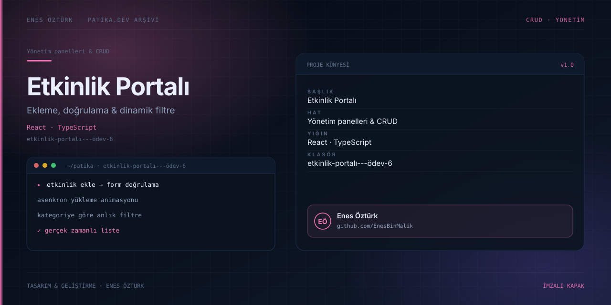

# Etkinlik Portalı - Ödev 6



> **Patika.dev arşivi · React · form yönetimi** — tasarım ve geliştirme: **Enes Öztürk**

---

Etkinlik ekleme, doğrulama ve dinamik filtreleme akışını uçtan uca gösteren gerçek zamanlı etkinlik portalı.

## Öne çıkanlar

- Etkinlik ekleme formu ve alan doğrulaması.
- Asenkron yükleme animasyonu.
- Kategori ve arama ile dinamik filtreleme.
- Etkinlik detay penceresi.

## Teknoloji

React · TypeScript · Vite. Her klasör kendi `package.json`'ına sahip bağımsız bir projedir; kök dizinde kurulum yapılmaz.

## Kurulum ve çalıştırma

```bash
cd "etkinlik-portalı---ödev-6"
npm install
npm run dev
```

| Komut | Not |
| --- | --- |
| `npm install` | bağımlılıklar |
| `npm run dev` | http://localhost:3000 |
| `npm run build` | üretim derlemesi |

## Proje yapısı

```
etkinlik-portalı---ödev-6/
├── index.html
├── package.json
├── docs/cover.svg            # imza kapak
└── src/
    ├── App.tsx               # ekranların birleştiği yer
    ├── main.tsx
    ├── assets/
    ├── components/
    ├── data/
    └── types/
```

## Lisans

Ödev ve portföy amaçlı çalışma; tüm hakları **Enes Öztürk**'e aittir.
