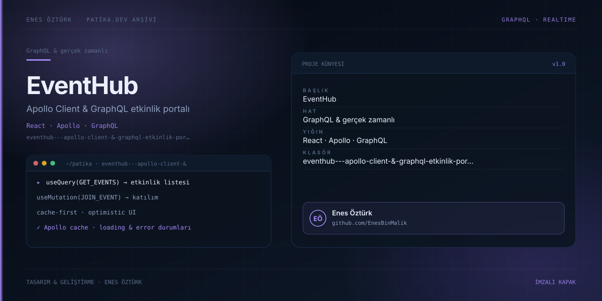

# EventHub - Apollo Client & GraphQL Etkinlik Portalı



> **Patika.dev arşivi · GraphQL · Apollo Client** — tasarım ve geliştirme: **Enes Öztürk**

---

Apollo Client üzerinden GraphQL sorgu ve mutation'larıyla çalışan etkinlik platformu: listeleme, katılım ve önbellek yönetimi.

## Öne çıkanlar

- `useQuery` ile etkinlik listesi.
- `useMutation` ile katılım ve kayıt akışı.
- Apollo önbelleği ve iyimser (optimistic) güncelleme.
- Yükleniyor ve hata durumlarının ele alınması.

## Teknoloji

React · TypeScript · Vite. Her klasör kendi `package.json`'ına sahip bağımsız bir projedir; kök dizinde kurulum yapılmaz.

## Kurulum ve çalıştırma

```bash
cd "eventhub---apollo-client-&-graphql-etkinlik-portalı"
npm install
npm run dev
```

| Komut | Not |
| --- | --- |
| `npm install` | bağımlılıklar |
| `npm run dev` | http://localhost:3000 |
| `npm run build` | üretim derlemesi |

## Proje yapısı

```
eventhub---apollo-client-&-graphql-etkinlik-portalı/
├── index.html
├── package.json
├── docs/cover.svg            # imza kapak
└── src/
    ├── App.tsx               # ekranların birleştiği yer
    ├── main.tsx
    ├── assets/
    ├── components/
    └── graphql/
```

## Lisans

Ödev ve portföy amaçlı çalışma; tüm hakları **Enes Öztürk**'e aittir.
