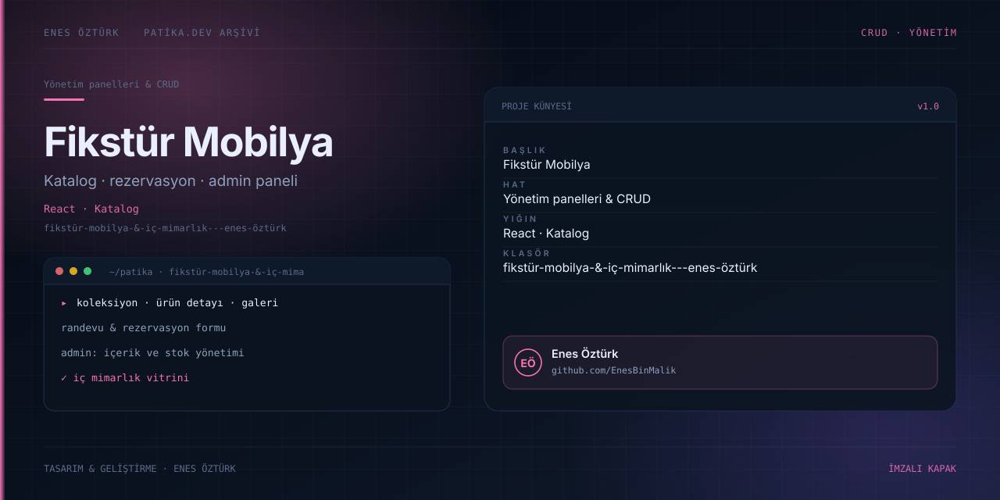

# Fikstür Mobilya & İç Mimarlık - Enes Öztürk



> **Patika.dev arşivi · Kurumsal vitrin · katalog** — tasarım ve geliştirme: **Enes Öztürk**

---

Mobilya ve iç mimarlık markası için katalog, rezervasyon ve yönetim panelini tek React uygulamasında toplayan vitrin.

## Öne çıkanlar

- Koleksiyon, ürün detayı ve galeri sayfaları.
- Randevu ve rezervasyon formu.
- Yönetim paneli: içerik ve stok.
- Sayfa bazlı yönlendirme ve Context ile sepet durumu.

## Teknoloji

React · TypeScript · Vite. Her klasör kendi `package.json`'ına sahip bağımsız bir projedir; kök dizinde kurulum yapılmaz.

## Kurulum ve çalıştırma

```bash
cd "fikstür-mobilya-&-i̇ç-mimarlık---enes-öztürk"
npm install
npm run dev
```

| Komut | Not |
| --- | --- |
| `npm install` | bağımlılıklar |
| `npm run dev` | http://localhost:3000 |
| `npm run build` | üretim derlemesi |

## Proje yapısı

```
fikstür-mobilya-&-i̇ç-mimarlık---enes-öztürk/
├── index.html
├── package.json
├── docs/cover.svg            # imza kapak
└── src/
    ├── App.tsx               # ekranların birleştiği yer
    ├── main.tsx
    ├── assets/
    ├── components/
    ├── context/
    ├── data/
    └── pages/
```

## Lisans

Ödev ve portföy amaçlı çalışma; tüm hakları **Enes Öztürk**'e aittir.
