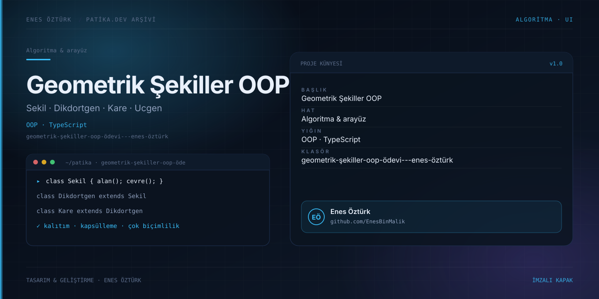

# Geometrik Şekiller OOP Ödevi - Enes Öztürk



> **Patika.dev arşivi · Nesne yönelimli programlama** — tasarım ve geliştirme: **Enes Öztürk**

---

`Sekil`, `Dikdortgen`, `Kare` ve `Ucgen` sınıflarıyla kalıtım, kapsülleme ve çok biçimliliği uygulayan interaktif OOP ödevi.

## Öne çıkanlar

- Dört şekil sınıfı ve alan/çevre hesapları.
- Kalıtım zinciri ve metot ezme (override).
- Girdi doğrulama ve hata mesajları.
- Her hesap için üretilen sınıf kodunun gösterimi.

## Teknoloji

React · TypeScript · Vite. Her klasör kendi `package.json`'ına sahip bağımsız bir projedir; kök dizinde kurulum yapılmaz.

## Kurulum ve çalıştırma

```bash
cd "geometrik-şekiller-oop-ödevi---enes-öztürk"
npm install
npm run dev
```

| Komut | Not |
| --- | --- |
| `npm install` | bağımlılıklar |
| `npm run dev` | http://localhost:3000 |
| `npm run build` | üretim derlemesi |

## Proje yapısı

```
geometrik-şekiller-oop-ödevi---enes-öztürk/
├── index.html
├── package.json
├── docs/cover.svg            # imza kapak
└── src/
    ├── App.tsx               # ekranların birleştiği yer
    ├── main.tsx
    ├── components/
    ├── data/
    └── models/
```

## Lisans

Ödev ve portföy amaçlı çalışma; tüm hakları **Enes Öztürk**'e aittir.
