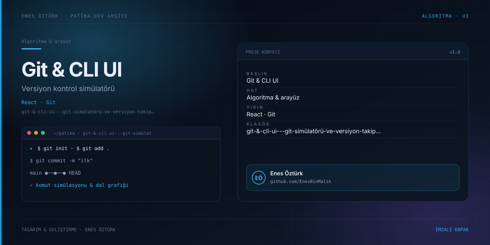

# Git & CLI UI - Git Simülatörü ve Versiyon Takip Paneli



> **Patika.dev arşivi · Versiyon kontrolü** — tasarım ve geliştirme: **Enes Öztürk**

---

Git komutlarının arka planda ne yaptığını ön yüzde görselleştiren simülatör: commit grafiği, dallar ve çalışma alanı durumu.

## Öne çıkanlar

- `init`, `add`, `commit`, `branch`, `checkout`, `merge` komut simülasyonu.
- Commit geçmişinin dal grafiği olarak çizimi.
- Çalışma alanı / hazırlık alanı (staging) durumu.
- Komut geçmişi ve adım adım açıklama.

## Teknoloji

React · TypeScript · Vite. Her klasör kendi `package.json`'ına sahip bağımsız bir projedir; kök dizinde kurulum yapılmaz.

## Kurulum ve çalıştırma

```bash
cd "git-&-cli-ui---git-simülatörü-ve-versiyon-takip-paneli"
npm install
npm run dev
```

| Komut | Not |
| --- | --- |
| `npm install` | bağımlılıklar |
| `npm run dev` | http://localhost:3000 |
| `npm run build` | üretim derlemesi |

## Proje yapısı

```
git-&-cli-ui---git-simülatörü-ve-versiyon-takip-paneli/
├── index.html
├── package.json
├── docs/cover.svg            # imza kapak
└── src/
    ├── App.tsx               # ekranların birleştiği yer
    ├── main.tsx
    ├── components/
    ├── services/
    └── types/
```

## Lisans

Ödev ve portföy amaçlı çalışma; tüm hakları **Enes Öztürk**'e aittir.
