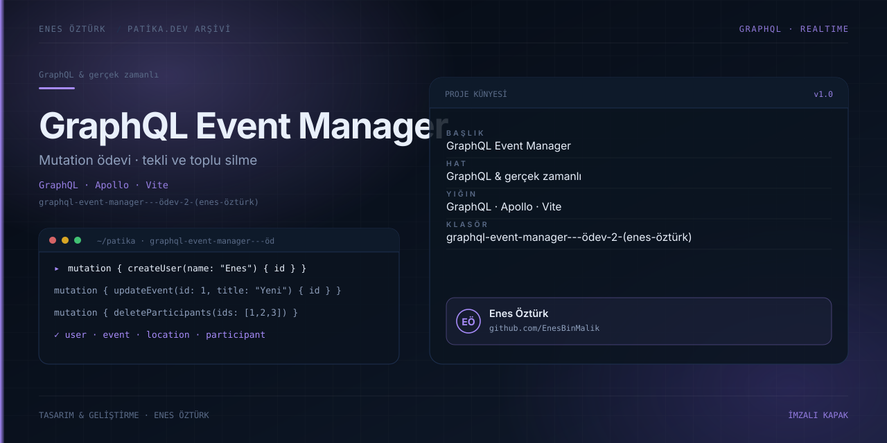

# GraphQL Event Manager - Ödev 2 (Enes Öztürk)



> **Patika.dev arşivi · GraphQL · mutation** — tasarım ve geliştirme: **Enes Öztürk**

---

User, Event, Location ve Participant nesneleri için ekleme, güncelleme, tekli ve toplu silme mutation'larını uygulayan ödev.

## Öne çıkanlar

- Dört nesne için tam mutation seti.
- Tekli ve toplu silme işlemleri.
- Şema görünümü ve sorgu denemesi.
- Değişiklik sonrası liste güncellemesi.

## Teknoloji

React · TypeScript · Vite. Her klasör kendi `package.json`'ına sahip bağımsız bir projedir; kök dizinde kurulum yapılmaz.

## Kurulum ve çalıştırma

```bash
cd "graphql-event-manager---ödev-2-(enes-öztürk)"
npm install
npm run dev
```

| Komut | Not |
| --- | --- |
| `npm install` | bağımlılıklar |
| `npm run dev` | http://localhost:3000 |
| `npm run build` | üretim derlemesi |

## Proje yapısı

```
graphql-event-manager---ödev-2-(enes-öztürk)/
├── index.html
├── package.json
├── docs/cover.svg            # imza kapak
└── src/
    ├── App.tsx               # ekranların birleştiği yer
    ├── main.tsx
    ├── components/
    └── graphql/
```

## Lisans

Ödev ve portföy amaçlı çalışma; tüm hakları **Enes Öztürk**'e aittir.
