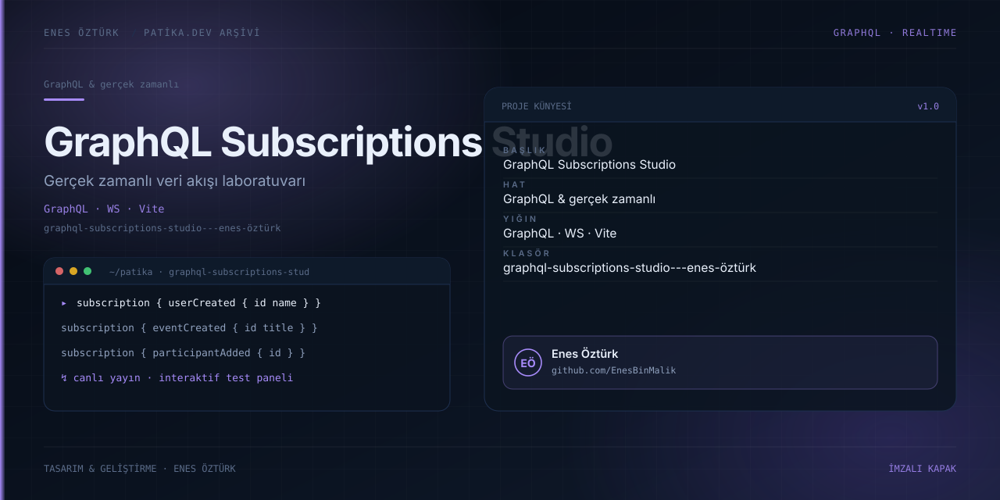

# GraphQL Subscriptions Studio - Enes Öztürk



> **Patika.dev arşivi · GraphQL · subscription** — tasarım ve geliştirme: **Enes Öztürk**

---

`userCreated`, `eventCreated` ve `participantAdded` abonelikleriyle gerçek zamanlı veri akışını test eden stüdyo.

## Öne çıkanlar

- Üç subscription için canlı yayın paneli.
- Olay tetikleme ve gelen veriyi izleme.
- Abonelik yaşam döngüsü (bağlan / bırak).
- İnteraktif test laboratuvarı.

## Teknoloji

React · TypeScript · Vite. Her klasör kendi `package.json`'ına sahip bağımsız bir projedir; kök dizinde kurulum yapılmaz.

## Kurulum ve çalıştırma

```bash
cd "graphql-subscriptions-studio---enes-öztürk"
npm install
npm run dev
```

| Komut | Not |
| --- | --- |
| `npm install` | bağımlılıklar |
| `npm run dev` | http://localhost:3000 |
| `npm run build` | üretim derlemesi |

## Proje yapısı

```
graphql-subscriptions-studio---enes-öztürk/
├── index.html
├── package.json
├── docs/cover.svg            # imza kapak
└── src/
    ├── App.tsx               # ekranların birleştiği yer
    ├── main.tsx
    ├── components/
    └── graphql/
```

## Lisans

Ödev ve portföy amaçlı çalışma; tüm hakları **Enes Öztürk**'e aittir.
