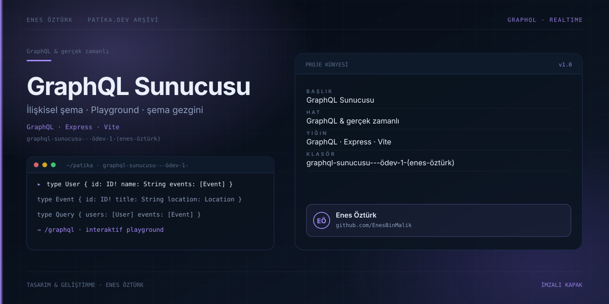

# GraphQL Sunucusu - Ödev 1 (Enes Öztürk)



> **Patika.dev arşivi · GraphQL · sunucu** — tasarım ve geliştirme: **Enes Öztürk**

---

Kullanıcı, etkinlik, konum ve katılımcı nesnelerini ilişkisel şemayla sunan GraphQL sunucusu ve playground.

## Öne çıkanlar

- İlişkisel şema: User → Event → Location → Participant.
- İnteraktif GraphQL Playground.
- Şema gezgini ve örnek sorgular.
- Veri seti yöneticisi.

## Teknoloji

React · TypeScript · Vite. Her klasör kendi `package.json`'ına sahip bağımsız bir projedir; kök dizinde kurulum yapılmaz.

## Kurulum ve çalıştırma

```bash
cd "graphql-sunucusu---ödev-1-(enes-öztürk)"
npm install
npm run dev
```

| Komut | Not |
| --- | --- |
| `npm install` | bağımlılıklar |
| `npm run dev` | http://localhost:3000 |
| `npm run build` | üretim derlemesi |

## Proje yapısı

```
graphql-sunucusu---ödev-1-(enes-öztürk)/
├── index.html
├── package.json
├── docs/cover.svg            # imza kapak
└── src/
    ├── App.tsx               # ekranların birleştiği yer
    ├── main.tsx
    ├── components/
    └── graphql/
```

## Lisans

Ödev ve portföy amaçlı çalışma; tüm hakları **Enes Öztürk**'e aittir.
