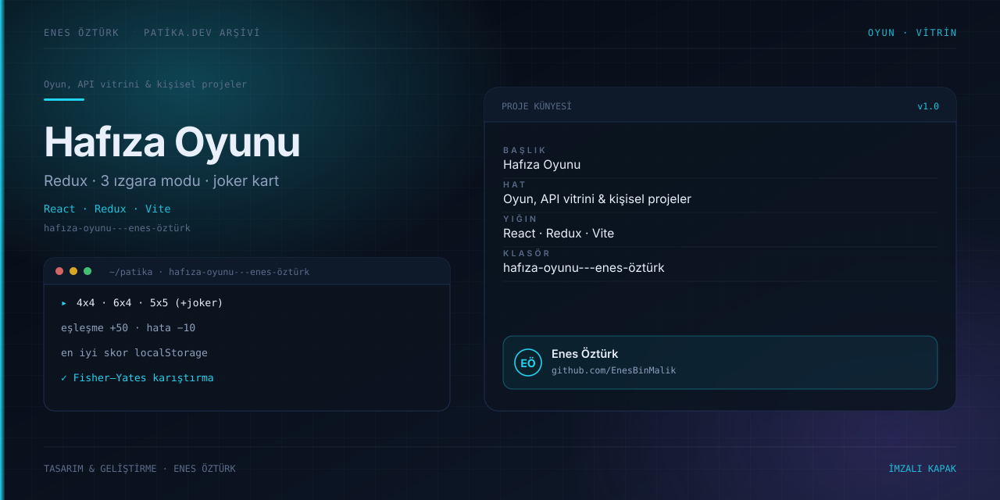

# Hafıza Oyunu — Teknoloji Kartları Eşleştirme



> **Patika.dev · React patikası — Hafıza oyunu ödevi** · Enes Öztürk

## Ne yapıyor?

Kapakları teknoloji markaları olan (React, Node.js, Rust, GraphQL, Vite …) bir eşleştirme oyunu. Üç
ızgara modu, puan/hamle/seri takibi, 5x5 modunda tek tıkla +50 veren joker kartı, Web Audio ile üretilen
ses efektleri ve `localStorage`'da saklanan en iyi skor içerir.

| Mod | Kart | Çift | Not |
| --- | --- | --- | --- |
| `4x4` | 16 | 8 | Standart |
| `6x4` | 24 | 12 | Geniş tahta |
| `5x5` | 25 | 12 + joker | 25. kart `pairId: 'joker-enes-ozturk'`, tek tıkla kendini eşleştirir |

Skor: eşleşme **+50**, eşleşmeyen deneme **−10** (`src/store/memorySlice.ts:173-203`). Hamle sayacı
ikinci kart açıldığında ve joker tıklandığında artar (`:148-151`, `:122`). İki kart açıkken tahta
850 ms kilitlenir (`src/components/GameBoard.tsx:18-51`).

## Teknoloji

React 19 · TypeScript · Vite 8 · **Redux Toolkit** (`src/store`) · Tailwind v4 · `lucide-react`
Ses: harici dosya yok, `src/utils/soundEffects.ts:16-25` osilatör ile üretiyor.

## Kurulum ve çalıştırma

```bash
npm install          # bun install da uygun (bun.lock depoda)
npm run dev          # http://localhost:3000
```

| Komut | Not |
| --- | --- |
| `npm run build` · `npm run preview` | Normal çalışır |
| `npm run lint` | `tsc --noEmit` — ESLint yapılandırması yok |
| `npm run clean` | Windows'ta çalışmaz (`rm -rf`) ve depoda olmayan `server.js`'yi hedefler |

## Proje yapısı

```
hafıza-oyunu---enes-öztürk/
├── src/
│   ├── main.tsx → App.tsx          # <Provider store={store}> ile sarılı tek ekran
│   ├── store/{index,memorySlice,hooks}.ts
│   ├── types/game.ts               # MemoryGameState (:22-35), GridMode (:14)
│   ├── data/cardData.ts            # Teknoloji kartları + joker (:109-116)
│   ├── utils/soundEffects.ts
│   └── components/                 # Header, ScoreBoard, GameBoard, CardItem, CardIcon, VictoryModal, Footer
└── docs/cover.svg
```

Kalıcı tek değer en iyi skordur: `localStorage` anahtarı `memory_game_best_score`
(`memorySlice.ts:78-85`).

## Dikkat edilen tasarım noktaları

- Karıştırma Fisher–Yates ile yapılıyor (`memorySlice.ts:5-12`) — `Math.random()` sıralama hatası yok.
- Tur çözümleme tek effect'te toplanmış, `setTimeout` unmount'ta temizleniyor (`GameBoard.tsx:44-47`).
- Kaydırmayı/ses gecikmelerini yöneten `setInterval` de temizleniyor (`GameBoard.tsx:55-58`).

## Bilinen kısıtlar ve yapılacaklar

- [ ] `5x5 / 4x4 / 6x4` zorluk değil **ızgara düzeni**; ayrı bir zorluk seviyesi ve süre (timer) modu yok.
- [ ] `TECH_CARDS.slice(0, pairCount)` (`memorySlice.ts:26`) her restart'ta aynı ilk 12 markayı veriyor —
      havuzdan rastgele seçim yapılmalı.
- [ ] `streak` gösteriliyor ama puana etkisi yok (`ScoreBoard.tsx:57-60`); ya etki ver ya da kaldır.
- [ ] Kart çifti seçimi `pairId` karşılaştırmasına dayalı; eşleşmeyen ikinci kartta `isBoardLocked`
      kalkmadan hızlı tıklama durumu test edilmeli.
- [ ] Kullanılmayan bağımlılıklar: `@google/genai`, `express`, `@types/express`, `dotenv`, `motion`,
      `autoprefixer`, `tsx`. `package.json` adı hâlâ `react-example`.
- [ ] `metadata.json` `MAJOR_CAPABILITY_SERVER_SIDE_GEMINI_API` diyor ama kod hiçbir Gemini/env okuması yapmıyor.
- [ ] Yorumlar İngilizce, kurallara gömülü ödev metinleri Türkçe — dil tutarlılığı sağlanmalı.
- [ ] Test yok; `memorySlice` reducer'ları için Vitest birim testleri eklenebilir.

## Lisans

Ödev amaçlı çalışma; Enes Öztürk'e ait.
