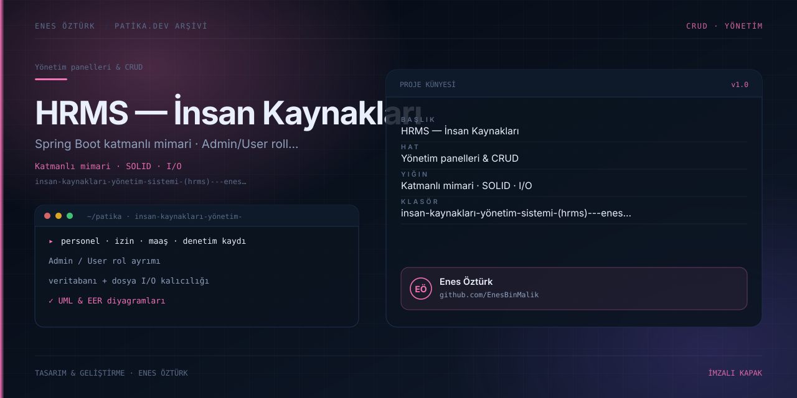

# İnsan Kaynakları Yönetim Sistemi (HRMS) - Enes Öztürk



> **Patika.dev arşivi · Kurumsal mimari · insan kaynakları** — tasarım ve geliştirme: **Enes Öztürk**

---

Spring Boot katmanlı mimarisi ve S.O.L.I.D ilkeleri örnek alınarak kurulmuş insan kaynakları portalı: personel, izin, maaş ve denetim kaydı tek panelde.

## Öne çıkanlar

- **Admin / User rolleri** — yetkiye göre açılan ekranlar.
- **Personel yönetimi** — kayıt, güncelleme, departman ve pozisyon.
- **İzin ve maaş modülleri** — talep, onay ve dönem takibi.
- **Veritabanı + dosya I/O** — kalıcılık iki katmanda (`src/core/database.ts`, `stream.ts`).
- **Denetim kaydı** ve UML/EER diyagram görünümleri.

## Teknoloji

React · TypeScript · Vite · katmanlı mimari. Her klasör kendi `package.json`'ına sahip bağımsız bir projedir; kök dizinde kurulum yapılmaz.

## Kurulum ve çalıştırma

```bash
cd "i̇nsan-kaynakları-yönetim-sistemi-(hrms)---enes-öztürk"
npm install
npm run dev
```

| Komut | Not |
| --- | --- |
| `npm install` | bağımlılıklar |
| `npm run dev` | http://localhost:3000 |
| `npm run build` | üretim derlemesi |
| `npm run lint` | tsc --noEmit |

## Proje yapısı

```
i̇nsan-kaynakları-yönetim-sistemi-(hrms)---enes-öztürk/
├── index.html
├── package.json
├── docs/cover.svg            # imza kapak
└── src/
    ├── App.tsx               # ekranların birleştiği yer
    ├── main.tsx
    ├── components/
    ├── core/
    ├── models/
    └── services/
```

## Lisans

Ödev ve portföy amaçlı çalışma; tüm hakları **Enes Öztürk**'e aittir.
