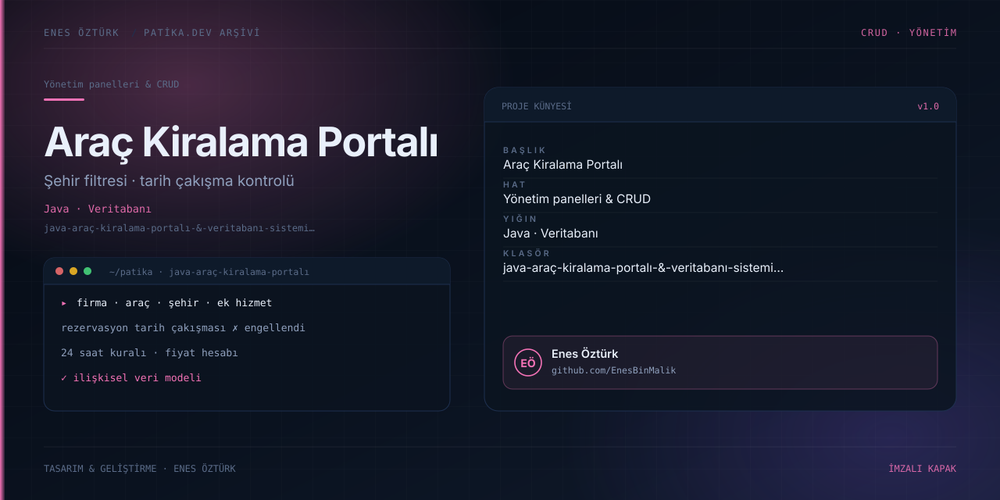

# Java Araç Kiralama Portalı & Veritabanı Sistemi — Enes Öztürk



> **Patika.dev arşivi · Java · ilişkisel veritabanı** — tasarım ve geliştirme: **Enes Öztürk**

---

Firma ve müşterilerin şehir bazlı filtreleme, tarih çakışma kontrolü ve 24 saat kuralıyla araç kiralayabildiği portal.

## Öne çıkanlar

- Araç, firma ve şehir bazlı arama.
- Rezervasyonlarda tarih çakışması kontrolü.
- Ek hizmet tanımlama ve fiyat hesabı.
- İlişkisel veri modeli ve yönetici görünümü.

## Teknoloji

React · TypeScript · Vite. Her klasör kendi `package.json`'ına sahip bağımsız bir projedir; kök dizinde kurulum yapılmaz.

## Kurulum ve çalıştırma

```bash
cd "java-araç-kiralama-portalı-&-veritabanı-sistemi-—-enes-öztürk"
npm install
npm run dev
```

| Komut | Not |
| --- | --- |
| `npm install` | bağımlılıklar |
| `npm run dev` | http://localhost:3000 |
| `npm run build` | üretim derlemesi |

## Proje yapısı

```
java-araç-kiralama-portalı-&-veritabanı-sistemi-—-enes-öztürk/
├── index.html
├── package.json
├── docs/cover.svg            # imza kapak
└── src/
    ├── App.tsx               # ekranların birleştiği yer
    ├── main.tsx
    ├── assets/
    ├── components/
    ├── data/
    ├── services/
    └── types/
```

## Lisans

Ödev ve portföy amaçlı çalışma; tüm hakları **Enes Öztürk**'e aittir.
