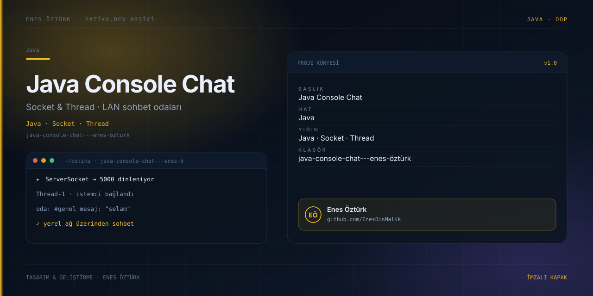

# Java Console Chat - Enes Öztürk



> **Patika.dev arşivi · Java · soket programlama** — tasarım ve geliştirme: **Enes Öztürk**

---

Java soket ve iş parçacığı (Socket & Thread) mimarisiyle yazılmış, yerel ağda çalışan sohbet odalı konsol uygulaması ve simülatörü.

## Öne çıkanlar

- Sunucu–istemci bağlantısı ve çoklu istemci desteği.
- Sohbet odaları ve kullanıcı adı yönetimi.
- Thread görselleştiricisi ile eşzamanlı akışın izlenmesi.
- LAN kurulum rehberi ve kaynak kod gezgini.

## Teknoloji

React · TypeScript · Vite. Her klasör kendi `package.json`'ına sahip bağımsız bir projedir; kök dizinde kurulum yapılmaz.

## Kurulum ve çalıştırma

```bash
cd "java-console-chat---enes-öztürk"
npm install
npm run dev
```

| Komut | Not |
| --- | --- |
| `npm install` | bağımlılıklar |
| `npm run dev` | http://localhost:3000 |
| `npm run build` | üretim derlemesi |

## Proje yapısı

```
java-console-chat---enes-öztürk/
├── index.html
├── package.json
├── docs/cover.svg            # imza kapak
└── src/
    ├── App.tsx               # ekranların birleştiği yer
    ├── main.tsx
    ├── components/
    ├── data/
    └── services/
```

## Lisans

Ödev ve portföy amaçlı çalışma; tüm hakları **Enes Öztürk**'e aittir.
