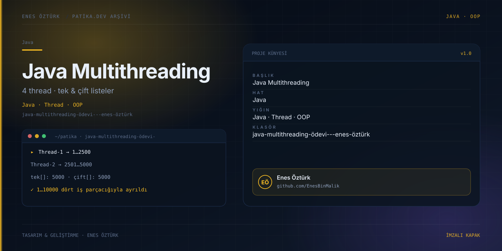

# Java Multithreading Ödevi — Simülasyon ve Kod İnceleme Aracı



> **Patika.dev · Java patikası — Multithreading ödevi** · Enes Öztürk

## Önemli: bu klasör neyi içeriyor?

Klasör adı Java ödevini işaret ediyor ama depoda **`.java`, `pom.xml` veya `build.gradle` dosyası yok**.
Gerçek proje, Java kaynak kodunu tarayıcıda gösteren ve thread davranışını **canlandıran** bir
Vite + React 19 + TypeScript uygulamasıdır. Java kodu `src/data/javaCode.ts` içinde üç şablon dize olarak
tutulur (`SINGLE_FILE_JAVA_CODE`, `OOP_JAVA_CODE`, `EXECUTOR_JAVA_CODE`) ve yalnızca renklendirilmiş
metin olarak render edilir; `javac` çalıştırılmaz.

Java'yı gerçekten çalıştırmak için:

```bash
# Header veya Kod sekmesinden .java dosyasını indir
javac -d out Main.java
java -cp out com.enesozturk.multithreading.Main
```

> İndirilen `OOP_JAVA_CODE` sürümünde iki ayrı `package` bildirimi var (`javaCode.ts:170` ve `:239`) ve
> tek `Main.java` olarak indirildiğinde derlenmez. Dosyayı iki kaynak dosyaya bölmek gerekir.

## Ne yapıyor?

Beş sekmeli bir inceleme aracı:

| Sekme | İçerik |
| --- | --- |
| **Simülasyon** | 4 thread'in sayı üretmesi, `join()` sırası, kilitli/kilitsiz çalışan senaryolar |
| **Kod** | Üç Java varyantının görüntülenmesi ve `.java` olarak indirilmesi |
| **Terminal** | `javac` / `java` çıktısının canlandırılması (sabit metin, canlı derleme değil) |
| **Mimari** | Thread + havuz diyagramı |
| **Rapor** | Ödev çıktı özeti |

## Kavramlar (kodda geçenler)

| Kavram | Görüldüğü satır |
| --- | --- |
| `new Thread(...)`, `start()` | `javaCode.ts:68-77` |
| `t1.join()` … `t4.join()` | `javaCode.ts:80-88` |
| `synchronized (ciftKilit)` / `synchronized (tekKilit)` | `javaCode.ts:115`, `:124` |
| `implements Runnable` | `javaCode.ts:136` |
| `Executors.newFixedThreadPool(4)` | `javaCode.ts:294` |
| `shutdown()` / `awaitTermination()` | `javaCode.ts:311-312` |
| `Collections.synchronizedList(...)` | `javaCode.ts:282` |

`volatile`, `ReentrantLock` veya `java.util.concurrent.atomic` kullanılmamış.

## Teknoloji

React 19 · TypeScript · Vite 8 · Tailwind v4 (`@tailwindcss/vite`) · `lucide-react`

## Kurulum ve çalıştırma

```bash
npm install
npm run dev        # http://localhost:3000
```

| Komut | Not |
| --- | --- |
| `npm run build` / `npm run preview` | Normal çalışır |
| `npm run lint` | `tsc --noEmit`; ESLint yapılandırması yok |
| `npm run clean` | `rm -rf` kullandığı için Windows'ta hata verir, olmayan `server.js`'yi hedefler |

## Proje yapısı

```
java-multithreading-ödevi---enes-öztürk/
├── index.html → src/main.tsx → src/App.tsx   # sekme durumu useState<AppTab>('simulation')
├── src/data/javaCode.ts                       # gösterilen Java kaynakları (367 satır)
├── src/types.ts                               # AppTab, ThreadStatus tanımları
├── src/components/                            # Header, SimulationTab, CodeViewerTab, TerminalTab, ArchitectureTab, ReportTab
└── docs/cover.svg
```

## Bilinen kısıtlar ve yapılacaklar

- [ ] "Canlı terminal" ve "%100 Doğrulandı" etiketleri gerçek dışı; simülasyon olduğu belirtilmeli.
- [ ] Race condition sabit olasılıkla modelleniyor (`Math.random() < 0.035`, `SimulationTab.tsx:174`),
      süre çıktısına `+ 4` ms ekleniyor (`:207`) — ölçüm değil, dekor.
- [ ] `TerminalTab.tsx:47` interval'i, `:67` ve `CodeViewerTab.tsx:28` timeout'ları unmount'ta temizlenmiyor.
- [ ] `App.tsx:9` ve `SimulationTab.tsx:14` içinde kullanılmayan ikon import'ları;
      `ThreadStatus` tipi `PAUSED` / `ERROR` ve `speed` `instant` hiç atanmıyor.
- [ ] `SimulationTab.tsx:314` `useEffect` bağımlılığında `handleStep` eksik → eski kapanış (stale closure).
- [ ] Kullanılmayan bağımlılıklar: `@google/genai`, `express`, `dotenv`, `motion`, `tsx`, `esbuild`.
- [ ] Sürüm aralıkları gerçek değil (`typescript ^7.0.2`, `vite ^8.3.0`) — sabitlenmeli.
- [ ] JUnit testi ve CI yok; asıl kazanç gerçek bir `src/main/java` klasörü eklemek olur.

## Lisans

Ödev amaçlı çalışma; Enes Öztürk'e ait.
