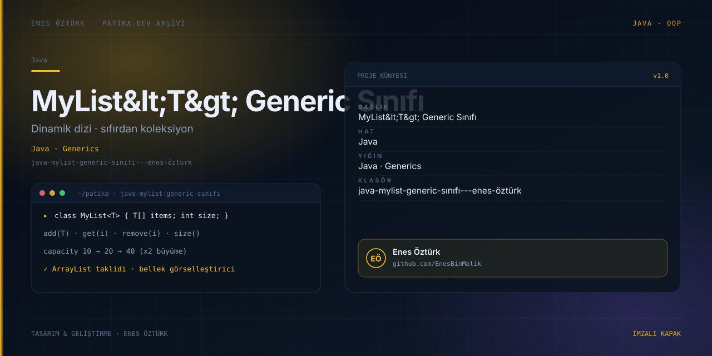

# Java MyList Generic Sınıfı - Enes Öztürk



> **Patika.dev arşivi · Java · generics** — tasarım ve geliştirme: **Enes Öztürk**

---

Java'nın koleksiyon sınıfları kullanılmadan, dinamik dizi üzerine kurulu `MyList<T>` sınıfının sıfırdan yazımı.

## Öne çıkanlar

- `add`, `get`, `remove`, `size` ve kapasite büyütme.
- Bellek görselleştiricisi: dizi ve elemanların durumu.
- Sınıfın kaynak kodunun adım adım gösterimi.
- Sınır durumları ve hata yönetimi.

## Teknoloji

React · TypeScript · Vite. Her klasör kendi `package.json`'ına sahip bağımsız bir projedir; kök dizinde kurulum yapılmaz.

## Kurulum ve çalıştırma

```bash
cd "java-mylist-generic-sınıfı---enes-öztürk"
npm install
npm run dev
```

| Komut | Not |
| --- | --- |
| `npm install` | bağımlılıklar |
| `npm run dev` | http://localhost:3000 |
| `npm run build` | üretim derlemesi |

## Proje yapısı

```
java-mylist-generic-sınıfı---enes-öztürk/
├── index.html
├── package.json
├── docs/cover.svg            # imza kapak
└── src/
    ├── App.tsx               # ekranların birleştiği yer
    ├── main.tsx
    ├── components/
    ├── data/
    └── models/
```

## Lisans

Ödev ve portföy amaçlı çalışma; tüm hakları **Enes Öztürk**'e aittir.
