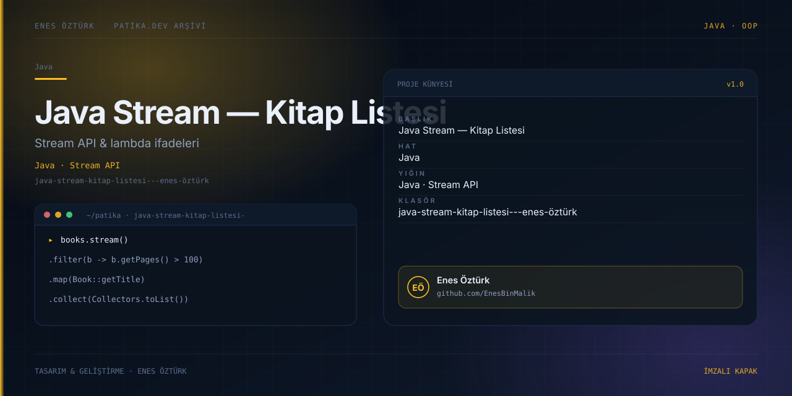

# Java Stream Kitap Listesi - Enes Öztürk



> **Patika.dev arşivi · Java · Stream API** — tasarım ve geliştirme: **Enes Öztürk**

---

Java 102 kapsamında Stream API ve lambda ifadeleriyle kitap listesini dönüştürme, filtreleme ve gruplama ödevi.

## Öne çıkanlar

- `stream().filter().map().collect()` zincirleri.
- Map dönüştürme ve sayfa sayısına göre filtreleme.
- Gruplama ve toplama işlemleri.
- Her adımın çıktısının gösterimi.

## Teknoloji

React · TypeScript · Vite. Her klasör kendi `package.json`'ına sahip bağımsız bir projedir; kök dizinde kurulum yapılmaz.

## Kurulum ve çalıştırma

```bash
cd "java-stream-kitap-listesi---enes-öztürk"
npm install
npm run dev
```

| Komut | Not |
| --- | --- |
| `npm install` | bağımlılıklar |
| `npm run dev` | http://localhost:3000 |
| `npm run build` | üretim derlemesi |

## Proje yapısı

```
java-stream-kitap-listesi---enes-öztürk/
├── index.html
├── package.json
├── docs/cover.svg            # imza kapak
└── src/
    ├── App.tsx               # ekranların birleştiği yer
    ├── main.tsx
    ├── components/
    ├── data/
    └── types/
```

## Lisans

Ödev ve portföy amaçlı çalışma; tüm hakları **Enes Öztürk**'e aittir.
