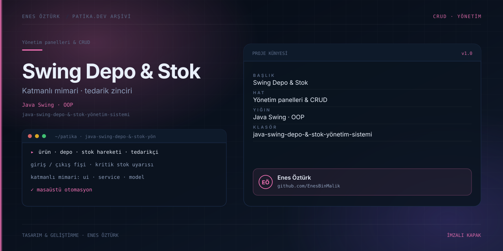

# Java Swing Depo & Stok Yönetim Sistemi



> **Patika.dev arşivi · Java Swing · katmanlı mimari** — tasarım ve geliştirme: **Enes Öztürk**

---

OOP ilkeleri ve Java Swing bileşenleriyle yazılmış, katmanlı mimariye sahip depo, stok ve tedarik zinciri otomasyonu.

## Öne çıkanlar

- Ürün, depo, stok hareketi ve tedarikçi yönetimi.
- Giriş/çıkış fişleri ve kritik stok uyarıları.
- Arayüz · servis · model katman ayrımı.
- Raporlama ekranı ve arama.

## Teknoloji

React · TypeScript · Vite. Her klasör kendi `package.json`'ına sahip bağımsız bir projedir; kök dizinde kurulum yapılmaz.

## Kurulum ve çalıştırma

```bash
cd "java-swing-depo-&-stok-yönetim-sistemi"
npm install
npm run dev
```

| Komut | Not |
| --- | --- |
| `npm install` | bağımlılıklar |
| `npm run dev` | http://localhost:3000 |
| `npm run build` | üretim derlemesi |

## Proje yapısı

```
java-swing-depo-&-stok-yönetim-sistemi/
├── index.html
├── package.json
├── docs/cover.svg            # imza kapak
└── src/
    ├── App.tsx               # ekranların birleştiği yer
    ├── main.tsx
    ├── components/
    ├── data/
    ├── services/
    └── types/
```

## Lisans

Ödev ve portföy amaçlı çalışma; tüm hakları **Enes Öztürk**'e aittir.
