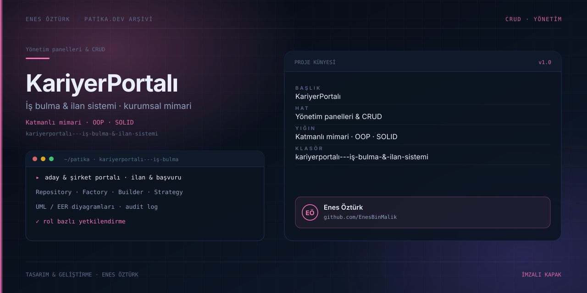

# KariyerPortalı - İş Bulma & İlan Sistemi



> **Patika.dev arşivi · Kurumsal mimari · iş bulma platformu** — tasarım ve geliştirme: **Enes Öztürk**

---

Aday ve şirket panellerini tek platformda toplayan kurumsal iş bulma sistemi: ilan, başvuru, filtreleme ve denetim kaydı; katmanlı mimari, OOP ve S.O.L.I.D ilkeleriyle kurgulanmış.

## Öne çıkanlar

- **Aday portalı** — profil, ilan arama, filtreleme ve başvuru.
- **Şirket portalı** — ilan yayınlama ve başvuru değerlendirme.
- **Tasarım desenleri** — Repository, Factory, Builder ve Strategy (`src/core/patterns`).
- **Katman ayrımı** — entities · repositories · services · security · types.
- **Belge görünümleri** — UML/EER diyagramları, Swagger görünümü ve denetim kaydı.

## Teknoloji

React · TypeScript · Vite · katmanlı mimari. Her klasör kendi `package.json`'ına sahip bağımsız bir projedir; kök dizinde kurulum yapılmaz.

## Kurulum ve çalıştırma

```bash
cd "kariyerportalı---i̇ş-bulma-&-i̇lan-sistemi"
npm install
npm run dev
```

| Komut | Not |
| --- | --- |
| `npm install` | bağımlılıklar |
| `npm run dev` | http://localhost:3000 |
| `npm run build` | üretim derlemesi |
| `npm run lint` | tsc --noEmit |

## Proje yapısı

```
kariyerportalı---i̇ş-bulma-&-i̇lan-sistemi/
├── index.html
├── package.json
├── docs/cover.svg            # imza kapak
└── src/
    ├── App.tsx               # ekranların birleştiği yer
    ├── main.tsx
    ├── components/
    └── core/
```

## Lisans

Ödev ve portföy amaçlı çalışma; tüm hakları **Enes Öztürk**'e aittir.
