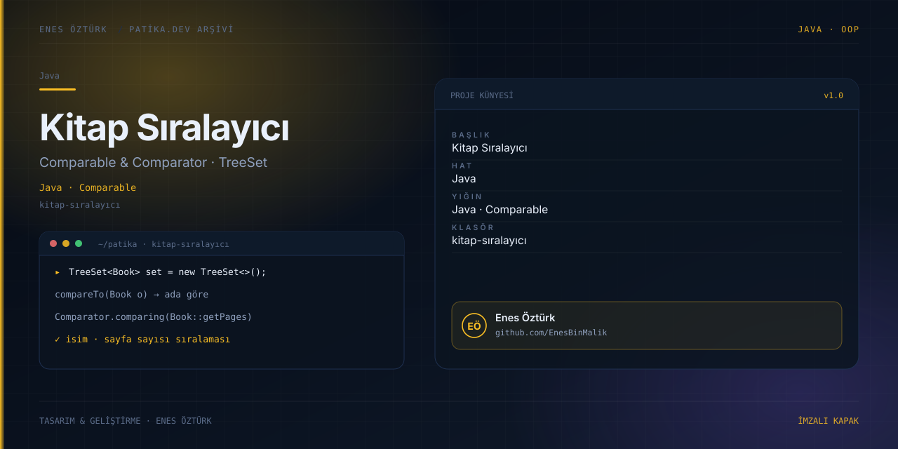

# Kitap Sıralayıcı



> **Patika.dev arşivi · Java · Comparable & Comparator** — tasarım ve geliştirme: **Enes Öztürk**

---

`Comparable` ve `Comparator` arayüzleriyle `TreeSet` üzerinde kitap adı ve sayfa sayısına göre sıralama yapan görselleştirici.

## Öne çıkanlar

- İsim ve sayfa sayısına göre iki sıralama ölçütü.
- TreeSet'e ekleme sırasında oluşan ağaç yapısı.
- Karşılaştırma adımlarının gösterimi.
- Kaynak kod ve konsol çıktısı.

## Teknoloji

React · TypeScript · Vite. Her klasör kendi `package.json`'ına sahip bağımsız bir projedir; kök dizinde kurulum yapılmaz.

## Kurulum ve çalıştırma

```bash
cd "kitap-sıralayıcı"
npm install
npm run dev
```

| Komut | Not |
| --- | --- |
| `npm install` | bağımlılıklar |
| `npm run dev` | http://localhost:3000 |
| `npm run build` | üretim derlemesi |

## Proje yapısı

```
kitap-sıralayıcı/
├── index.html
├── package.json
├── docs/cover.svg            # imza kapak
└── src/
    ├── App.tsx               # ekranların birleştiği yer
    ├── main.tsx
    ├── assets/
    ├── components/
    ├── data/
    ├── types/
    └── utils/
```

## Lisans

Ödev ve portföy amaçlı çalışma; tüm hakları **Enes Öztürk**'e aittir.
