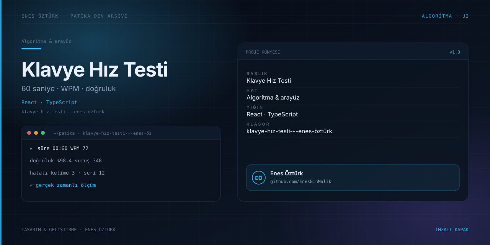

# Klavye Hız Testi - Enes Öztürk



> **Patika.dev arşivi · React · zamanlayıcı** — tasarım ve geliştirme: **Enes Öztürk**

---

60 saniyelik testte kelime/dakika (WPM), doğruluk ve vuruş analizi ölçen yazma antrenmanı.

## Öne çıkanlar

- Gerçek zamanlı WPM ve doğruluk hesabı.
- Hatalı kelime ve seri takibi.
- Süre sayacı ve test sonu özeti.
- Yeniden başlatma ve metin havuzu.

## Teknoloji

React · TypeScript · Vite. Her klasör kendi `package.json`'ına sahip bağımsız bir projedir; kök dizinde kurulum yapılmaz.

## Kurulum ve çalıştırma

```bash
cd "klavye-hız-testi---enes-öztürk"
npm install
npm run dev
```

| Komut | Not |
| --- | --- |
| `npm install` | bağımlılıklar |
| `npm run dev` | http://localhost:3000 |
| `npm run build` | üretim derlemesi |

## Proje yapısı

```
klavye-hız-testi---enes-öztürk/
├── index.html
├── package.json
├── docs/cover.svg            # imza kapak
└── src/
    ├── App.tsx               # ekranların birleştiği yer
    ├── main.tsx
    ├── components/
    ├── data/
    └── utils/
```

## Lisans

Ödev ve portföy amaçlı çalışma; tüm hakları **Enes Öztürk**'e aittir.
