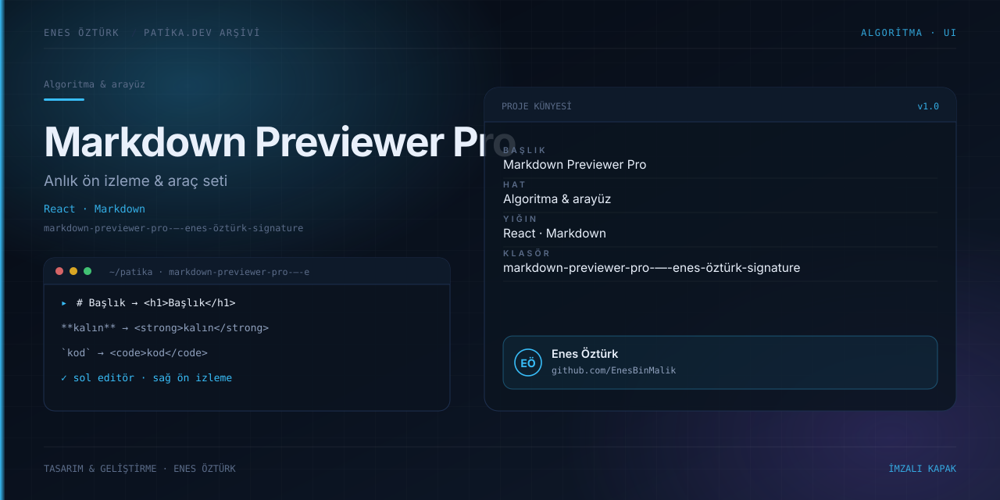

# Markdown Previewer Pro — Enes Öztürk Signature



> **Patika.dev arşivi · Metin işleme · editör** — tasarım ve geliştirme: **Enes Öztürk**

---

Soldan girilen Markdown'ı sağda anında ön izleyen, araç çubuğu ve kılavuz içeren editör.

## Öne çıkanlar

- Anlık iki panelli ön izleme.
- Başlık, kalın, liste ve kod ekleme araçları.
- Markdown kılavuzu ve kısayollar.
- Kopyalama ve temizleme.

## Teknoloji

React · TypeScript · Vite. Her klasör kendi `package.json`'ına sahip bağımsız bir projedir; kök dizinde kurulum yapılmaz.

## Kurulum ve çalıştırma

```bash
cd "markdown-previewer-pro-—-enes-öztürk-signature"
npm install
npm run dev
```

| Komut | Not |
| --- | --- |
| `npm install` | bağımlılıklar |
| `npm run dev` | http://localhost:3000 |
| `npm run build` | üretim derlemesi |

## Proje yapısı

```
markdown-previewer-pro-—-enes-öztürk-signature/
├── index.html
├── package.json
├── docs/cover.svg            # imza kapak
└── src/
    ├── App.tsx               # ekranların birleştiği yer
    ├── main.tsx
    ├── components/
    ├── data/
    ├── styles/
    └── utils/
```

## Lisans

Ödev ve portföy amaçlı çalışma; tüm hakları **Enes Öztürk**'e aittir.
