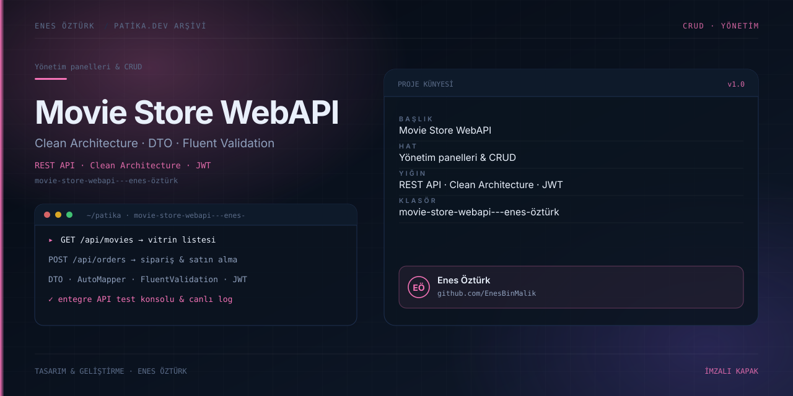

# Movie Store WebAPI - Enes Öztürk



> **Patika.dev arşivi · REST API · Clean Architecture** — tasarım ve geliştirme: **Enes Öztürk**

---

Film mağazası için katmanlı RESTful WebAPI ve ona bağlı mağaza arayüzü: film listesi, sepet, sipariş, kimlik doğrulama ve entegre API test konsolu.

## Öne çıkanlar

- **Katmanlar** — `server/controllers · services · di · dtos · mapping · validation`.
- **DTO + AutoMapper** ile model dönüşümü, **FluentValidation** ile kural doğrulama.
- **JWT kimlik doğrulama** ve rol bazlı yönetim paneli.
- **Sipariş & satın alma** akışı ve stok kontrolü.
- **API Explorer**, canlı log görüntüleyici ve birim test koşucusu.

## Teknoloji

React · TypeScript · Vite + Node/TS API. Her klasör kendi `package.json`'ına sahip bağımsız bir projedir; kök dizinde kurulum yapılmaz.

## Kurulum ve çalıştırma

```bash
cd "movie-store-webapi---enes-öztürk"
npm install
npm run dev
```

| Komut | Not |
| --- | --- |
| `npm install` | bağımlılıklar |
| `npm run dev` | http://localhost:3000 — API + arayüz aynı portta |
| `npm run build` | üretim derlemesi |
| `npm start` | tsx server.ts |

## Proje yapısı

```
movie-store-webapi---enes-öztürk/
├── index.html
├── package.json
├── docs/cover.svg            # imza kapak
└── src/
    ├── App.tsx               # ekranların birleştiği yer
    ├── main.tsx
    ├── api/
    └── components/
```

## Lisans

Ödev ve portföy amaçlı çalışma; tüm hakları **Enes Öztürk**'e aittir.
