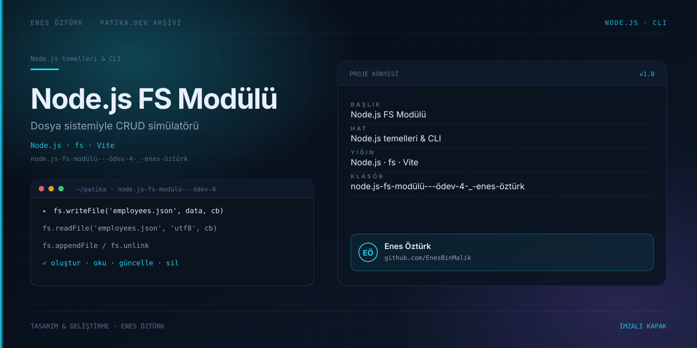

# Node.js FS Modülü - Ödev 4 | Enes Öztürk



> **Patika.dev arşivi · Node.js · fs modülü** — tasarım ve geliştirme: **Enes Öztürk**

---

`fs` modülüyle dosya oluşturma, okuma, güncelleme ve silme adımlarını gösteren CRUD simülatörü.

## Öne çıkanlar

- `writeFile`, `readFile`, `appendFile`, `unlink` akışları.
- JSON dosyası üzerinde çalışan örnek veri.
- Adım adım kod ve çıktı gösterimi.
- Hata durumlarının ele alınması.

## Teknoloji

React · TypeScript · Vite. Her klasör kendi `package.json`'ına sahip bağımsız bir projedir; kök dizinde kurulum yapılmaz.

## Kurulum ve çalıştırma

```bash
cd "node.js-fs-modülü---ödev-4-_-enes-öztürk"
npm install
npm run dev
```

| Komut | Not |
| --- | --- |
| `npm install` | bağımlılıklar |
| `npm run dev` | http://localhost:3000 |
| `node index.cjs` | konsol sürümü |

## Proje yapısı

```
node.js-fs-modülü---ödev-4-_-enes-öztürk/
├── index.html
├── package.json
├── docs/cover.svg            # imza kapak
└── src/
    ├── App.tsx               # ekranların birleştiği yer
    ├── main.tsx
    ├── components/
    ├── data/
    └── services/
```

## Lisans

Ödev ve portföy amaçlı çalışma; tüm hakları **Enes Öztürk**'e aittir.
