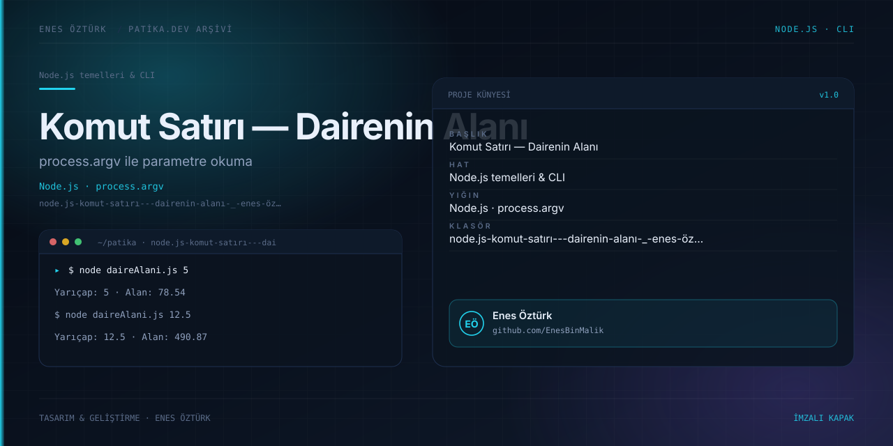

# Node.JS Komut Satırı - Dairenin Alanı | Enes Öztürk



> **Patika.dev arşivi · Node.js · CLI** — tasarım ve geliştirme: **Enes Öztürk**

---

`process.argv` ile komut satırından yarıçap alıp dairenin alanını hesaplayan ödev; interaktif terminal ve geometrik görselleştirme eşliğinde.

## Öne çıkanlar

- `process.argv` ile parametre okuma.
- Girdi doğrulama ve Türkçe hata mesajları.
- İnteraktif terminal simülasyonu.
- Daire görselleştirmesi ve kaynak kod.

## Teknoloji

React · TypeScript · Vite. Her klasör kendi `package.json`'ına sahip bağımsız bir projedir; kök dizinde kurulum yapılmaz.

## Kurulum ve çalıştırma

```bash
cd "node.js-komut-satırı---dairenin-alanı-_-enes-öztürk"
node daireAlani.js 5
npm install
```

| Komut | Not |
| --- | --- |
| `node daireAlani.js 5` | alan hesabı |
| `npm install` | bağımlılıklar |
| `npm run dev` | http://localhost:3000 |

## Proje yapısı

```
node.js-komut-satırı---dairenin-alanı-_-enes-öztürk/
├── index.html
├── package.json
├── docs/cover.svg            # imza kapak
└── src/
    ├── App.tsx               # ekranların birleştiği yer
    ├── main.tsx
    ├── components/
    └── data/
```

## Lisans

Ödev ve portföy amaçlı çalışma; tüm hakları **Enes Öztürk**'e aittir.
