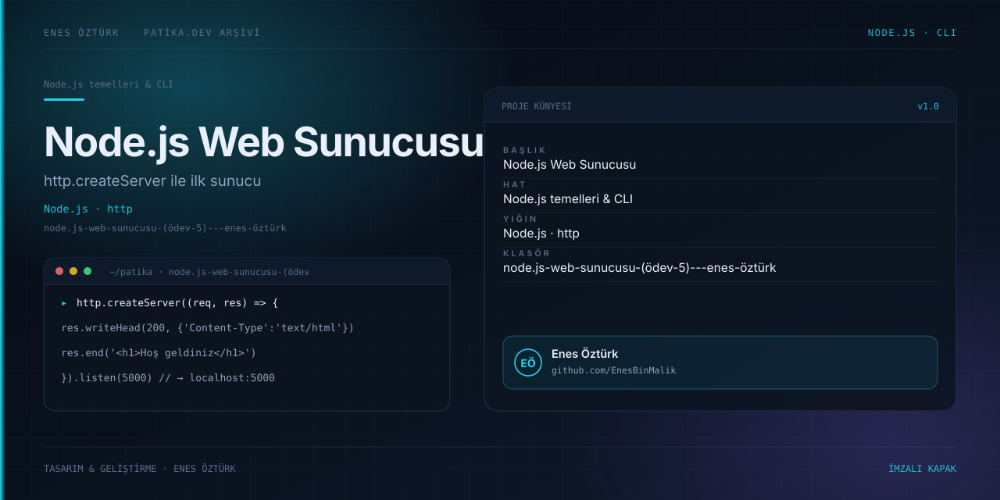

# Node.js Web Sunucusu — Ödev 5

<div align="center">
  

  **HTTP istek ve yanıt akışını tarayıcıda deneyimleyin.**

  [](https://nodejs.org/)
  [](https://react.dev/)
  [](https://www.typescriptlang.org/)
</div>

## Proje hakkında

Node.js web sunucusu ödevinin kavramlarını tarayıcıda canlandıran öğrenme arayüzü. Uygulama, bir **etkileşimli simülatördür**: tarayıcı görünümü, terminal, testler ve örnek yanıtlar istemci tarafında canlandırılır; bu proje klasöründe gerçek HTTP sunucusu başlatan `server.ts` bulunmaz.

## Neler var?

- **Tarayıcı simülatörü:** `/`, `/hakkimda` ve `/iletisim` rotaları ile tanımsız rotalarda 404 yanıtını deneme.
- **Terminal ve istek kayıtları:** simüle edilen GET isteklerini, durum kodlarını ve yanıt boyutlarını inceleme.
- **Kod görünümü:** ödevdeki sunucu yaklaşımını açıklayan örnekleri okuma.
- **Test kontrol listesi:** tanımlı rotaların beklenen yanıtlarını deneme.
- **Yerel rehber ve teslim kartı:** çalışma adımları ve ödev özeti.

## Çalıştırma

Gereksinim: Node.js ve npm.

```bash
npm install
npm run dev
```

Vite geliştirme sunucusu varsayılan olarak `http://localhost:3000` adresinde açılır. Derleme için `npm run build`, derleme önizlemesi için `npm run preview` kullanın.

## Kullanım

1. **Simülatör** sekmesinde bir rota seçin veya yazın.
2. Son HTTP yanıtını ve terminalde oluşan isteği karşılaştırın.
3. **Testler**, **Kod** ve **Rehber** sekmeleriyle ödevin farklı parçalarını inceleyin.
4. **Sunucu** durum düğmesi simülatörün istek kabul edip etmediğini değiştirir; gerçek bir Node sürecini yönetmez.

## Proje yapısı

```text
src/
├── App.tsx                       # Sekmeler, simüle edilen rotalar ve yanıtlar
├── components/                   # Tarayıcı, terminal, test, rehber ve kod görünümleri
└── types.ts                      # Sunucu kayıt türleri
docs/cover.svg                    # Proje kapağı
```

Bu çalışma Patika.dev ödev arşivinin parçasıdır. Depodaki diğer klasörler için [üst dizin README](../README.md)'ye bakın.

---

<div align="center">

**Enes Öztürk** · [@EnesBinMalik](https://github.com/EnesBinMalik)

*HTTP'yi görselleştirerek öğren.*

</div>
