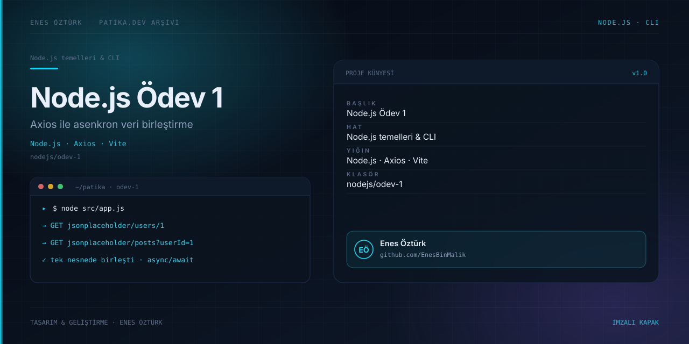

# odev-1



> **Patika.dev arşivi · Node.js · asenkron API** — tasarım ve geliştirme: **Enes Öztürk**

---

JSONPlaceholder API'sinden bir kullanıcıyı ve gönderilerini Axios ile asenkron çekip tek nesnede birleştiren ödev.

## Öne çıkanlar

- Axios ile paralel iki istek.
- `async/await` ve `Promise.all` kullanımı.
- Gelen verilerin tek nesnede birleştirilmesi.
- Hata yönetimi ve konsol çıktısı.

## Teknoloji

React · TypeScript · Vite. Her klasör kendi `package.json`'ına sahip bağımsız bir projedir; kök dizinde kurulum yapılmaz.

## Kurulum ve çalıştırma

```bash
cd "nodejs/odev-1"
npm install
npm run dev
```

| Komut | Not |
| --- | --- |
| `npm install` | bağımlılıklar |
| `npm run dev` | http://localhost:3000 |
| `npm run build` | üretim derlemesi |

## Proje yapısı

```
odev-1/
├── index.html
├── package.json
├── docs/cover.svg            # imza kapak
└── src/
    ├── App.tsx               # ekranların birleştiği yer
    ├── main.tsx
    └── lib/
```

## Lisans

Ödev ve portföy amaçlı çalışma; tüm hakları **Enes Öztürk**'e aittir.
