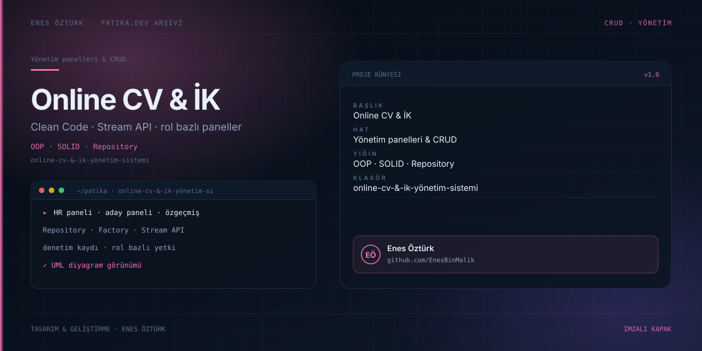

# Online CV & İK Yönetim Sistemi



> **Patika.dev arşivi · Kurumsal mimari · İK & özgeçmiş** — tasarım ve geliştirme: **Enes Öztürk**

---

Özgeçmiş oluşturma ile insan kaynakları yönetimini aynı portalda birleştiren sistem; S.O.L.I.D, OOP ve Clean Code ilkeleriyle katmanlı olarak kurgulanmış.

## Öne çıkanlar

- **Aday paneli** — özgeçmiş oluşturma, düzenleme ve görüntüleme.
- **HR paneli** — başvuru, pozisyon ve değerlendirme akışı.
- **Katmanlar** — `core · repositories · patterns · services · database`.
- **Stream API** benzeri koleksiyon işlemleri ve Repository deseni.
- **Denetim kaydı** ve UML diyagram görünümü.

## Teknoloji

React · TypeScript · Vite · katmanlı mimari. Her klasör kendi `package.json`'ına sahip bağımsız bir projedir; kök dizinde kurulum yapılmaz.

## Kurulum ve çalıştırma

```bash
cd "online-cv-&-i̇k-yönetim-sistemi"
npm install
npm run dev
```

| Komut | Not |
| --- | --- |
| `npm install` | bağımlılıklar |
| `npm run dev` | http://localhost:3000 |
| `npm run build` | üretim derlemesi |
| `npm run lint` | tsc --noEmit |

## Proje yapısı

```
online-cv-&-i̇k-yönetim-sistemi/
├── index.html
├── package.json
├── docs/cover.svg            # imza kapak
└── src/
    ├── App.tsx               # ekranların birleştiği yer
    ├── main.tsx
    ├── components/
    ├── core/
    ├── database/
    ├── patterns/
    ├── repositories/
    └── services/
```

## Lisans

Ödev ve portföy amaçlı çalışma; tüm hakları **Enes Öztürk**'e aittir.
