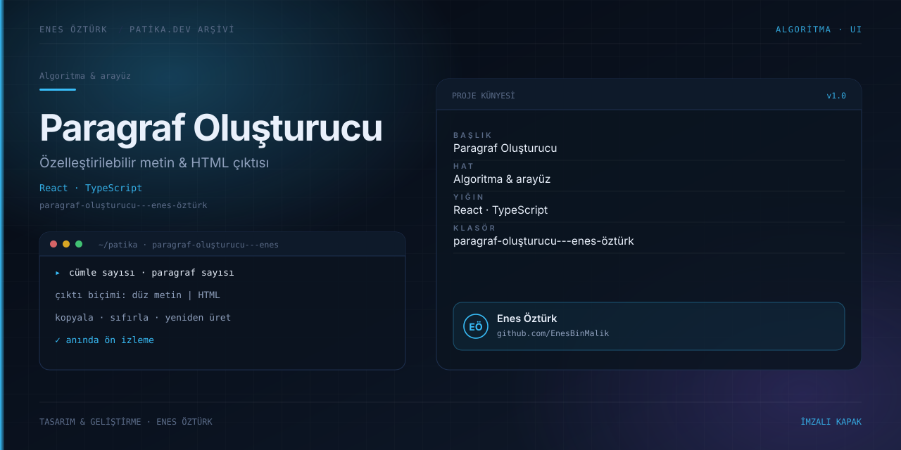

# Paragraf Oluşturucu - Enes Öztürk



> **Patika.dev arşivi · Metin üretimi** — tasarım ve geliştirme: **Enes Öztürk**

---

Cümle ve paragraf sayısı seçilerek özelleştirilebilir metin ya da HTML çıktısı üreten araç.

## Öne çıkanlar

- Cümle ve paragraf sayısı seçimi.
- Düz metin veya HTML çıktısı.
- Kopyala ve sıfırla.
- Anında ön izleme.

## Teknoloji

React · TypeScript · Vite. Her klasör kendi `package.json`'ına sahip bağımsız bir projedir; kök dizinde kurulum yapılmaz.

## Kurulum ve çalıştırma

```bash
cd "paragraf-oluşturucu---enes-öztürk"
npm install
npm run dev
```

| Komut | Not |
| --- | --- |
| `npm install` | bağımlılıklar |
| `npm run dev` | http://localhost:3000 |
| `npm run build` | üretim derlemesi |

## Proje yapısı

```
paragraf-oluşturucu---enes-öztürk/
├── index.html
├── package.json
├── docs/cover.svg            # imza kapak
└── src/
    ├── App.tsx               # ekranların birleştiği yer
    ├── main.tsx
    ├── components/
    └── services/
```

## Lisans

Ödev ve portföy amaçlı çalışma; tüm hakları **Enes Öztürk**'e aittir.
