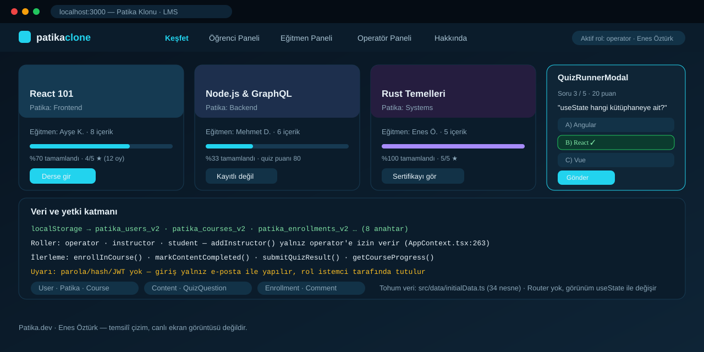

# Patika Klonu — Eğitim ve Öğrenim Yönetim Platformu



> **Patika.dev · Full-stack patikası** · Enes Öztürk
> Üç rollük (operatör / eğitmen / öğrenci) bir LMS arayüzü; veri tamamen tarayıcıda `localStorage`'da tutuluyor.

## Ne yapıyor?

Patika.dev'in kendi tema ve akışlarıyla küçültülmüş bir klonu: katalog gezme, derse kayıt, video içerik,
quiz, yorum ve puanlama, rol bazlı paneller ve içerik CRUD'u. Backend, veritabanı ve HTTP API **yoktur** —
tüm state React Context içinde tutulur ve 8 adet `patika_*_v2` anahtarıyla `localStorage`'a yazılır.

| Rol | Panel | Yetenek |
| --- | --- | --- |
| `operator` | Operatör | Patika (kategori) ve eğitmen tanımlama, ders açma/silme, tüm içerikler üzerinde düzenleme |
| `instructor` | Eğitmen | Kendi derslerine içerik (YouTube bağlantısı) ve quiz sorusu ekleme, kendi içeriklerini silme |
| `student` | Öğrenci | Derslere kayıt olma, içeriği tamamlanmış işaretleme, quiz çözme, yorum ve yıldız verme |

## Teknoloji

React 19 · TypeScript · Vite 8 · Tailwind v4 · **Context API** (Redux yok) · Router **yok** —
görünüm değişimi `useState<string>('explore')` ile yapılıyor (`src/App.tsx:12-55`), bu yüzden derin
bağlantı (deep link) ve tarayıcı geri düğmesi çalışmaz.

## Kurulum ve çalıştırma

```bash
npm install          # depoda kilit dosyası yok, sürümler serbest aralıkta çözülür
npm run dev          # http://localhost:3000
```

| Komut | Not |
| --- | --- |
| `npm run build` · `npm run preview` | Normal çalışır |
| `npm run lint` | `tsc --noEmit`; ESLint yok |
| `npm run clean` | Windows'ta çalışmaz (`rm -rf`), olmayan `server.js`'yi hedefler |

Veriyi sıfırlamak için operatör panelindeki **Verileri Varsayılana Sıfırla** düğmesi
(`OperatorDashboard.tsx:725-733`, `window.confirm` onaylı) veya devtools'ta `localStorage` anahtarlarını
silmek yeterli; silinirse `src/data/initialData.ts` tohum verisi yeniden yüklenir.

## Veri modeli (`src/types/index.ts`)

`User` (`:1-12`, `role: operator | instructor | student`) · `Patika` (`:14-24`) · `Course` (`:26-35`) ·
`Content` (`:48-58`, `youtubeUrl`, `durationMinutes`, `order`) · `QuizQuestion` (`:37-46`) ·
`ContentComment` (`:60-71`, 1–5 yıldız, beğeni) · `Enrollment` (`:73-89`, tamamlanan içerikler ve quiz puanları).

Tohum veri 34 nesne: 6 kullanıcı, 3 patika, dersler, içerikler, quiz soruları, yorumlar, kayıtlar
(`initialData.ts:3, 66, 102, 165, 261, 341, 392`).

## Mantığın haritası (`src/context/AppContext.tsx`, 685 satır)

| Konu | Satır |
| --- | --- |
| Giriş/kayıt: `loginAsUser`, `loginWithEmail`, `registerStudent`, `logout` | `:206-254` |
| Rol bekçileri (`addInstructor` yalnız operatör; içerik sahipliği kontrolleri) | `:263-265`, `:354-451` |
| Ders/patika CRUD ve kaskat silme | `:291-343` |
| İçerik + quiz ekleme, silmede bağlı soruları temizleme | `:346-426`, `:399` |
| İlerleme: kayıt, tamamlama, quiz puanı, ilerleme yüzdesi | `:458-543`, `:608-616` |
| Yorum, beğeni, ortalama puan | `:545-592` |
| `localStorage` hydrate + 8 write-back effect | `:94-203` |

## Güvenlik notu (bunu bilerek kullan)

Bu bir ödev prototipidir, **gerçek kimlik doğrulama yoktur**:

- `User` tipinde parola alanı yok (`types/index.ts:3-12`); `loginWithEmail` yalnız e-postaya bakıyor
  (`AppContext.tsx:213-221`) — bilinen herhangi bir e-posta ile o rolün yetkileri alınabilir.
- İlk açılışta uygulama otomatik olarak `INITIAL_USERS[0]`, yani operatör Enes Öztürk olarak giriş yapıyor
  (`AppContext.tsx:107-108`). `AuthModal.tsx` içinde tek tıkla rol değiştirme (`handleQuickLogin`) da var.
- Rol ve tüm veri `localStorage`'da; devtools ile değiştirilebilir. Rol kontrolleri yalnızca arayüzü
  düzenler, sunucu tarafında hiçbir şeyi korumaz.

## Bilinen kısıtlar ve yapılacaklar

- [ ] Router yok → `react-router` ile kalıcı URL'ler; derin bağlantı ve geri düğmesi desteği.
- [ ] Kimlik doğrulama gerçek değil → backend (Express/Prisma veya Supabase) + parola hash'i ve oturum token'ı.
- [ ] Varlık ID'leri `Date.now()` üretiyor (`AppContext.tsx:241, 276, 294, 311, 363, 420, 466, 549`) —
      hızlı çift gönderimde çakışma riski; `crypto.randomUUID()` kullanılmalı.
- [ ] Puanı olmayan içerik için `getContentAverageRating` `{ average: 5, count: 0 }` dönüyor (`:589`),
      arayüzde "5 yıldız" görünüyor; `count === 0` durumu ayrıştırılmalı.
- [ ] `AuthModal.tsx:52` ve `StudentDashboard.tsx:100` içindeki `setTimeout`'lar temizlenmiyor.
- [ ] Avatarlar harici Unsplash bağlantılarıyla geliyor, yeni içerikte sabit bir YouTube adresi
      varsayılan (`InstructorDashboard.tsx:109`) — yerel asset veya kullanıcı girişi olmalı.
- [ ] Kullanılmayan bağımlılıklar: `@google/genai`, `express`, `@types/express`, `dotenv`, `motion`,
      `autoprefixer`, `tsx`; `metadata.json` hâlâ Gemini yeteneği iddia ediyor; `package.json` adı `react-example`.
- [ ] Kilit dosyası ve CI yok; test yok (özellikle `submitQuizResult` ve ilerleme hesabı için birim testi gerekir).

## Lisans

Ödev amaçlı çalışma; Enes Öztürk'e ait.
