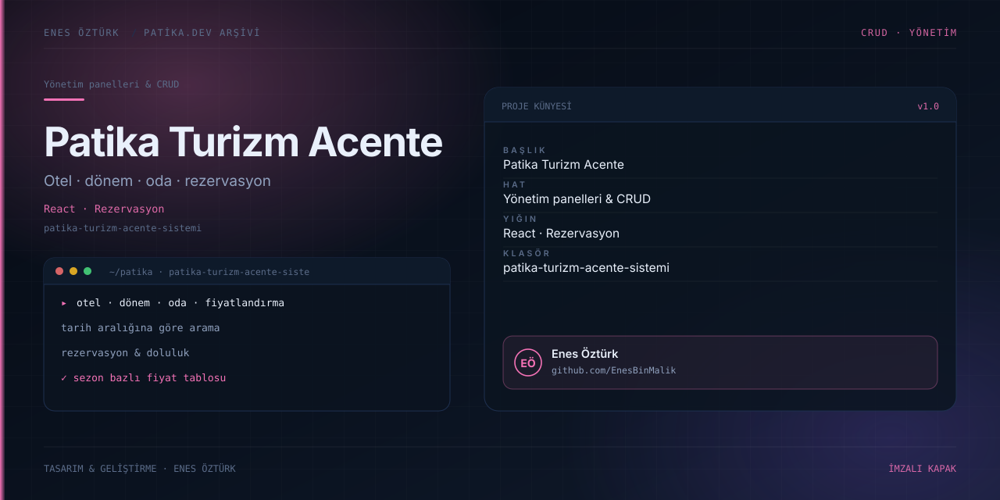

# Patika Turizm Acente Sistemi



> **Patika.dev arşivi · Rezervasyon sistemi** — tasarım ve geliştirme: **Enes Öztürk**

---

Otel, dönem, oda ve fiyatlandırma üzerine kurulu arama ve rezervasyon yönetim platformu.

## Öne çıkanlar

- Otel ve dönem bazlı oda listesi.
- Tarih aralığına göre arama.
- Sezon bazlı fiyatlandırma.
- Rezervasyon ve doluluk görünümü.

## Teknoloji

React · TypeScript · Vite. Her klasör kendi `package.json`'ına sahip bağımsız bir projedir; kök dizinde kurulum yapılmaz.

## Kurulum ve çalıştırma

```bash
cd "patika-turizm-acente-sistemi"
npm install
npm run dev
```

| Komut | Not |
| --- | --- |
| `npm install` | bağımlılıklar |
| `npm run dev` | http://localhost:3000 |
| `npm run build` | üretim derlemesi |

## Proje yapısı

```
patika-turizm-acente-sistemi/
├── index.html
├── package.json
├── docs/cover.svg            # imza kapak
└── src/
    ├── App.tsx               # ekranların birleştiği yer
    ├── main.tsx
    ├── assets/
    ├── components/
    ├── context/
    ├── data/
    └── types/
```

## Lisans

Ödev ve portföy amaçlı çalışma; tüm hakları **Enes Öztürk**'e aittir.
