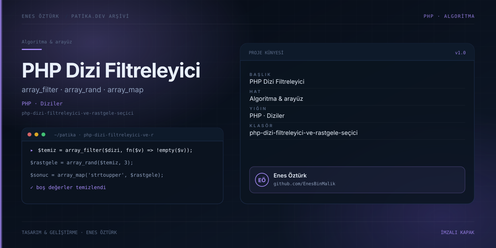

# PHP Dizi Filtreleyici ve Rastgele Seçici



> **Patika.dev arşivi · PHP · dizi fonksiyonları** — tasarım ve geliştirme: **Enes Öztürk**

---

`array_filter`, `array_rand` ve `array_map` ile boş değerleri temizleyip rastgele alt dizi üreten fonksiyon ve simülatörü.

## Öne çıkanlar

- Boş değerlerin filtrelenmesi.
- Rastgele eleman seçimi.
- Dönüştürme ve yeniden indeksleme.
- Adım adım çıktı gösterimi.

## Teknoloji

React · TypeScript · Vite. Her klasör kendi `package.json`'ına sahip bağımsız bir projedir; kök dizinde kurulum yapılmaz.

## Kurulum ve çalıştırma

```bash
cd "php-dizi-filtreleyici-ve-rastgele-seçici"
npm install
npm run dev
```

| Komut | Not |
| --- | --- |
| `npm install` | bağımlılıklar |
| `npm run dev` | http://localhost:3000 |
| `npm run build` | üretim derlemesi |

## Proje yapısı

```
php-dizi-filtreleyici-ve-rastgele-seçici/
├── index.html
├── package.json
├── docs/cover.svg            # imza kapak
└── src/
    ├── App.tsx               # ekranların birleştiği yer
    ├── main.tsx
    ├── components/
    ├── types/
    └── utils/
```

## Lisans

Ödev ve portföy amaçlı çalışma; tüm hakları **Enes Öztürk**'e aittir.
